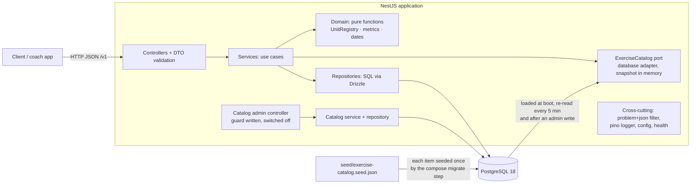

# Workout Logging API

An HTTP API for coaches who track their clients' training: log workouts (one
entry or many), read the history with filters and cursor pagination, and ask
for personal records (PRs) and a comparison of two periods. NestJS 12,
PostgreSQL 18, Drizzle ORM, Docker Compose.

> ## The five `/v1/admin` routes are unauthenticated
>
> **Anyone who can reach the API can add, change and delete catalog exercises
> and muscle groups, for every user.** That is the owner's decision for this
> version, and it matches the rest of the API, which has no authentication at
> all (the brief says to pass `userId` as a parameter). A guard is written and
> tested; two commented-out lines in one file switch it on. See
> [Catalog administration](#catalog-administration).
>
> Do not expose this API beyond a trusted network as it is.

Where each deliverable of the brief is:

| Deliverable | Section |
|---|---|
| D2 Architecture overview | [Architecture](#architecture) |
| D3 Setup | [Running it](#running-it) |
| D4 API documentation | [API](#api), [Errors](#errors) |
| D5 Schema and design decisions | [Database schema and decisions](#database-schema-and-decisions) |
| D6 Trade-offs and what changes at scale | [Trade-offs](#trade-offs), [At scale](#at-scale), [Replicas and the catalog](#replicas-and-the-catalog) |

The performance evidence is under [Performance](#performance). The rest of
the repository: `requests.http` (every call shown here, runnable),
`AI_WORKFLOW.md`, `ESTIMATE.md`, and `planning/` (the design and the reasons
for each decision).

Evidence tags mark factual claims that are not obvious: **[V]** checked
against a primary source or by running it, **[BP]** best practice, **[K]**
recalled knowledge, **[J]** judgment, **[U]** not verified. The evidence
behind each is in `planning/05-research-notes.md`.

## Architecture



The application is layered, not hexagonal: controller, then service, then
(domain, repository, catalog). Dependencies run one way. The domain layer has
no Nest, no I/O and no database types, so every calculation is a plain unit
test. Abstractions exist only where the brief asks for extensibility: the
`UnitRegistry` (adding a unit is one line) and the `ExerciseCatalog` (the
exercise to muscle-group mapping is data, not code). Both are injected by
token. Three use cases do not need CQRS or event sourcing.

```
src/
  main.ts, app.module.ts, app.setup.ts   the app is built the same way by main.ts and by the tests
  config/            the environment schema (operational settings only)
  common/            problem+json filter, cursor codec, JSON-only body rule, limits.ts (input caps),
                     admin-token.guard.ts (written and tested, not applied)
  cli/migrate.ts     the compose `migrate` step: one lock, the migrations, then the catalog seed
  database/          Drizzle provider, schema.ts (query types), migrations/*.sql (written by hand)
  units/             weight-units.ts (the one list of units), UnitRegistry, GET /units
  exercises/         the two key functions, the catalog port and its database adapter,
                     catalog service and repository, the seed, the public and admin controllers
  workouts/          DTOs, controller, service, repository, domain/ (metrics, dates)
  personal-records/  controller, service, repository, domain/ (delta)
  health/
seed/exercise-catalog.seed.json   the catalog's initial content: a seed, not the source of truth
scripts/             benchmark data and runner, the clean-image check (development tools)
```

Two tables hold the workouts (entries and sets). Four small tables hold the
exercise catalog. Records are never stored: they are computed from the sets
on every read, so no write can leave a stale record.

## Catalog administration

The catalog says which exercises are known and which muscle groups each one
trains. It is data in the database, edited through five routes, so that
adding or correcting an exercise needs no code change and no deploy.
`seed/exercise-catalog.seed.json` (12 muscle groups, 87 exercises) is only
its initial content.

**These five routes are open in the version as delivered.** Each route's
OpenAPI description, the OpenAPI tag "Admin — catalog (UNAUTHENTICATED)", the
comment above them in `requests.http` and this section all say so.

| Route | Body | Success | Errors |
|---|---|---|---|
| `POST /v1/admin/exercises` | `{ name, muscleGroups }` | 201 + `Location`, the exercise | 400; 409 `EXERCISE_EXISTS` |
| `PUT /v1/admin/exercises/{exerciseKey}` | `{ name, muscleGroups }`, a full replacement | 200, the exercise | 400 (including a `name` whose key differs from the path); 404 |
| `DELETE /v1/admin/exercises/{exerciseKey}` | none | 204 | 404 |
| `POST /v1/admin/muscle-groups` | `{ name }` | 201, the group | 400; 409 `MUSCLE_GROUP_EXISTS` |
| `DELETE /v1/admin/muscle-groups/{name}` | none | 204 | 404; 409 `MUSCLE_GROUP_IN_USE` |

What an anonymous caller can do through them: change which muscle groups
entries show and what the muscle-group filter matches, for every user. What
they cannot do through these routes: read, change or delete a logged entry
or a PR. That is a statement about these five routes only; the logging and
reading routes have no authentication either, so anyone who can reach the API
can already read and write any user's entries.

How it behaves:

- **Muscle groups are a closed list.** `"cheast"` on an exercise is a 400 that
  lists the known groups. A new group is one call, `POST /v1/admin/muscle-groups`.
  There is no rename for a group in v1: add the new one, PUT the exercises that
  use the old one, delete the old one. A group an exercise still lists cannot
  be deleted (409, saying how many exercises list it).
- **The key is fixed.** An exercise's key is its name normalised (NFKC, trimmed,
  spaces collapsed, lower case). PUT may change the muscle groups and any
  spelling that keeps the same key (`bench press` to `Bench Press`). A name
  with a different key is a 400: a different name is a different exercise, so
  POST it and delete the old one.
- **Delete removes the catalog row and nothing else.** Logged entries stay in
  history with their PRs intact, show `muscleGroups: []` and stop matching the
  muscle-group filter. POSTing the same name again restores the mapping for all
  of that history at once, because groups are resolved by key at read time.
- **Deleting a muscle group makes that group a 400 in the history filter**
  (it is no longer a known group).
- **A deleted seeded exercise is not brought back by a redeploy.** The seed
  gives each item of the file to a database once (it keeps a ledger). To
  restore one, POST it again, or delete its row from `catalog_seed_ledger` and
  run `migrate` again. An item an admin edited keeps the admin's version; an
  item removed or changed in the file does nothing, because the database is the
  source of truth.
- **A catalog change reaches every replica within five minutes.** The replica
  that handled the write shows it at once. On another replica, meanwhile, a
  new exercise shows no muscle groups yet, an edited one shows its old groups,
  and a new group is not yet a valid filter value. Stored entries and PRs are
  never affected, because an entry holds only its key. The catalog's own `GET`
  routes read the tables, so an admin checking a change always sees it.
- **The catalog's size is not limited.** A caller can add rows until the
  snapshot every replica holds is large. Stopping that is a gateway's rate
  limit, like every other abuse limit.
- **Last write wins.** Two admins changing one exercise at once: the later PUT
  stands. There is no `ETag` / `If-Match`; a catalog has one or two editors and
  a lost edit shows on the next read and is fixed by one more PUT. Each write is
  one transaction under an advisory lock, so two at once end cleanly (a 409 or
  404, or the second result), never a 500.
- **A key can contain a slash** (`90/90 Hip Stretch`), so `Location` is written
  with `encodeURIComponent`: `/v1/exercises/90%2F90%20hip%20stretch`. A proxy in
  front of the API that decodes `%2F` before forwarding breaks such keys
  (Express decodes `%2F` inside a path segment, and a literal slash is a 404)
  **[V]**.
- Every catalog write logs one line (route, key, outcome). With the routes
  open, that line is the only record of who changed what and when.

### Switching the guard on

The guard (`src/common/admin-token.guard.ts`) is written and has its own unit
test, and a second test applies it to the real controller: all five routes
answer 401 without the token and succeed with it, and `GET /v1/exercises` is
unaffected. It is not applied in the version as delivered. To apply it:

1. In `src/exercises/catalog-admin.controller.ts`, uncomment the two lines
   marked `1. uncomment` and `2. uncomment`: the import of `AdminOnly` and the
   `@AdminOnly()` decorator above the class. The import is commented out too
   because an unused import fails `npm run lint` (not the type check), and the
   lint is part of CI. With the helper, switching on touches exactly these two
   lines.
2. Set `ADMIN_API_TOKEN` to a secret of **at least 32 characters**. A shorter
   value stops the process from starting, and the message names the variable,
   never its value. Under compose, put it in your shell or a `.env` file; it has
   no default anywhere.
3. Clients send `Authorization: Bearer <the token>` on the five admin routes.

A wrong or missing token is a 401 `UNAUTHORIZED` problem with a
`WWW-Authenticate: Bearer` header. The guard compares SHA-256 digests with
`crypto.timingSafeEqual`, so a token of another length is a plain "no". **With
the two lines uncommented and the variable empty or unset, every admin route
answers 401, by design:** the guard fails closed.

Why switching it on is a code change and not an environment setting: which
routes are protected is behaviour, and behaviour is reviewed like any code. The
token is a per-environment secret, so it is configuration. A shared static
token is the smallest thing that closes the door; the platform's real answer is
a role check on the caller's identity, and the guard is where it would go.

## Running it

You need Docker with Compose. Nothing else.

```bash
docker compose up --build
```

That starts PostgreSQL 18, runs the one-shot `migrate` step (under one lock:
the migrations, then the catalog seed), and then starts the API. No `.env` file
is needed: compose carries development defaults. When the API logs
`Listening`, it is ready:

```bash
curl http://localhost:3000/health/ready
curl http://localhost:3000/v1/exercises/bench%20press
```

- The API is on **http://localhost:3000**, the Swagger UI on
  `http://localhost:3000/docs`, the OpenAPI document on `/docs-json`.
- PostgreSQL is published on `127.0.0.1:55432` only (not 5432, so a PostgreSQL
  already running on your machine does not stop `up`, and the database is not
  exposed beyond the machine). `docker compose exec postgres psql -U workout`
  needs no published port.
- If port 3000 or 55432 is taken, pick others:
  `API_PORT=3100 DB_HOST_PORT=55433 docker compose up --build`.
- `requests.http` holds every call in this README, ready to send.
- `docker compose down -v` stops everything and **deletes the database volume**.

A plain `up` starts with the catalog seeded and **no workout data**, so a
reviewer begins from an empty log. Benchmark data is opt-in:
`docker compose --profile bench up bench` (see [Performance](#performance)).

**The `api` process exits if it cannot load the catalog at boot** (it retries
for about ten seconds), and compose restarts it (`restart: on-failure`), so a
database that is late or briefly down costs a restart, not a dead service.
Outside compose, `node dist/cli/migrate.js` is the release step: it runs the
migrations and the seed together, with `DATABASE_URL` in the environment. `api`
never runs either.

### Tests and checks

Node 26 and Docker (the integration tests start a real PostgreSQL with
Testcontainers; there is no mocked database).

```bash
npm ci
npm run lint && npm run typecheck
npm test            # unit tests
npm run test:int    # integration tests against PostgreSQL in Docker
bash scripts/clean-image-check.sh
```

- **The `npm test` and `npm run test:int` scripts start with `TZ=Asia/Ho_Chi_Minh`,
  a POSIX shell prefix, which does not run in Windows `cmd` or PowerShell.** On
  Windows use WSL, Git Bash, Docker or CI. The tests run in a zone that is
  neither UTC nor the database's session zone (`America/Los_Angeles`), so a value
  that passes through either by accident comes out wrong and a test fails.
- **`scripts/clean-image-check.sh` runs `docker compose down -v`, which removes
  a developer's compose database** (the volume of this project). It builds the
  image, starts the stack from nothing without the `bench` profile, waits for
  readiness, reads a seeded exercise, checks the image holds no `.env` and no
  development dependency, and removes the project's containers and volume when
  it finishes. Run it on a machine where that is fine.
- CI (GitHub Actions) runs lint, typecheck, build, unit, integration, and then
  the clean-image check. There is no benchmark job; `npm run bench` runs on
  demand.

## API

Base path `/v1`, except `/health/live`, `/health/ready`, `/docs` and
`/docs-json`. Bodies are JSON only; any other media type on a route that takes
a body is a 415 (parameters such as `charset=utf-8` are ignored). Success
bodies are `{ data, page?, message? }`. `userId` is a path segment: an opaque
string of 1 to 64 characters from `A-Z a-z 0-9 _ . -`. A well-formed unknown
user has no entries and gets a 200 with an empty result.

| Method | Path | Purpose | Success |
|---|---|---|---|
| POST | `/users/{userId}/workout-entries` | Log one entry | 201 + `Location` |
| POST | `/users/{userId}/workout-entries/bulk` | Log 1 to 100 entries atomically | 201 |
| GET | `/users/{userId}/workout-entries` | History | 200 |
| GET | `/users/{userId}/workout-entries/{id}` | One entry (the target of `Location`) | 200 / 404 |
| GET | `/users/{userId}/personal-records` | PRs for one exercise | 200 |
| GET | `/users/{userId}/personal-records/compare` | PRs in two periods and the change | 200 |
| GET | `/exercises` | The catalog: every exercise with its muscle groups | 200 |
| GET | `/exercises/{exerciseKey}` | One catalog exercise | 200 / 404 |
| GET | `/muscle-groups` | The known muscle groups | 200 |
| GET | `/units` | Supported units and their aliases | 200 |
| POST, PUT, DELETE | `/admin/exercises…`, `/admin/muscle-groups…` | [Catalog administration](#catalog-administration) (open) | 201 / 200 / 204 |
| GET | `/health/live`, `/health/ready` | Liveness, database readiness | 200 / 503 |
| GET | `/docs`, `/docs-json` | Swagger UI, OpenAPI | 200 |

On the four routes that read query parameters (history, one entry, PRs and
compare), a parameter the route does not accept is a 400 that names it and
lists the accepted ones, and a parameter sent twice, or with an empty value, is
a 400 too; so is an `exercise` of spaces only, or one holding the NUL
character. Otherwise `?exerciseName=bench` (the body's field name) would return
the unfiltered list, which reads as an answer. Every response is documented in
`/docs`, including each route's problem responses; every example there, and in
this README and `requests.http`, is a full date-time with an offset.

### What a first request looks like

```bash
curl -X POST http://localhost:3000/v1/users/u_123/workout-entries \
  -H 'Content-Type: application/json' \
  -d '{ "date": "2025-02-10T05:30:00+07:00",
        "exerciseName": "Bench Press",
        "sets": [ { "reps": 5, "weight": 225, "unit": "lbs" },
                  { "reps": 3, "weight": 105, "unit": "kg" } ] }'
```

```json
201   Location: /v1/users/u_123/workout-entries/0194f2fe-…
{ "data": {
    "id": "0194f2fe-…", "userId": "u_123",
    "exerciseName": "Bench Press", "exerciseKey": "bench press",
    "muscleGroups": ["chest", "shoulders", "triceps"],
    "date": "2025-02-09T22:30:00.000Z", "utcOffset": "+07:00",
    "sets": [
      { "setNumber": 1, "reps": 5, "weight": 102.06, "unit": "kg", "original": { "weight": 225, "unit": "lb" } },
      { "setNumber": 2, "reps": 3, "weight": 105,    "unit": "kg", "original": { "weight": 105, "unit": "kg" } } ],
    "createdAt": "2025-02-11T03:12:45.120Z" } }
```

The POST answers in **kilograms**, and each set carries `original`: the number
as sent and the canonical unit code (`"lbs"` comes back as `"lb"`). A workout at
05:30 in Vietnam comes back with the previous UTC day in `date`; `utcOffset`
says where it was logged (see [Time](#time-and-time-zones)). `GET` takes
`?unit=` to show the weights in another unit: the same entry with `?unit=lb`
shows the first set as `225` and the second as `231.49`.

The brief lists `userId` among an entry's fields, so a first request often has
it in the body. It is accepted when it equals the path value (on a single
entry and on each bulk item) and is not stored twice. A different value is a 400
naming the field, never silently ignored.

**Log many.** `POST …/workout-entries/bulk` takes `{ "entries": [ <same
shape>, … ] }` (1 to 100) and returns `{ "data": [ … ] }` in the order sent. It
is one transaction: if any entry is invalid, nothing is stored. It has no
`Location` header, because it creates many resources; each item carries its
`id`. An array sent to the single route, or a bare array sent to `/bulk`, is a
400 whose message shows the expected shape. Every problem of a request comes
back in one response, each with its path (`entries[2].sets[0].unit`), so a
client fixes a request in one round.

| Field | Rule |
|---|---|
| `date` | required; an RFC 3339 date-time with `Z` or an offset (some ISO 8601 variants tolerated); a date alone, or a date-time with no offset, is a 400; an offset from -12:00 to +14:00 in whole minutes; a zone in brackets is accepted and ignored; no later than now + 15 minutes; not before `1900-01-01T00:00:00Z` |
| `exerciseName` | required string, 1 to 100 characters after trimming, and its key 1 to 100 characters too |
| `sets` | required array, 1 to 50 items |
| `sets[].reps` | integer, 1 to 1 000 |
| `sets[].weight` | finite number, 0 to 10 000, at most 3 decimal places (0 = bodyweight) |
| `sets[].unit` | a unit code or alias, case-insensitive: `kg`, `kgs`, `lb`, `lbs` (`GET /v1/units`) |
| `userId` | optional; must equal the path `userId` |
| `entries` (bulk) | 1 to 100 items |
| any other property | rejected |

Numbers sent as strings (`"weight": "225"`, `"reps": "5"`, as form-driven
clients send them) are a 400 naming each field and saying the quotes are the
fault; they are never converted silently.

**History.**

```
GET /v1/users/u_123/workout-entries?exercise=bench&muscleGroup=chest
    &from=2025-01-31T17:00:00Z&to=2025-02-28T17:00:00Z&unit=lb&limit=20&cursor=…
```

| Parameter | Rule |
|---|---|
| `exercise` | optional, 1 to 100 characters; case-insensitive substring of the exercise name; `%`, `_` and `\` match themselves |
| `muscleGroup` | optional; a group of the catalog (`GET /v1/muscle-groups`), else a 400 listing them |
| `from`, `to` | optional date-times with `Z` or an offset; half-open, **`from` included, `to` excluded**; each usable alone |
| `unit` | optional, default `kg` |
| `limit` | 1 to 100, default 20 |
| `cursor` | opaque; send the `nextCursor` of the previous page unchanged; malformed is a 400 |

```json
200
{ "data": [ { "…": "entries, newest first" } ],
  "page": { "limit": 20, "hasMore": true, "nextCursor": "eyJ2IjoxLC…" } }
```

No match is a **200** with `"data": []`, `"page": { …, "hasMore": false,
"nextCursor": null }` and `"message": "No workout entries found for the given
filters."`, not an error. There is no `total`: counting every match on each page
is the expensive part at scale, and keyset pagination does not need it. Order
is `date` descending, then `id` descending (see [Time](#time-and-time-zones)).

**Personal records.**

```
GET /v1/users/u_123/personal-records?exercise=Bench%20Press&unit=kg[&from=…][&to=…]
```

`exercise` is required and matched **exactly after normalisation**: it must be
the whole name. `bench` does not find `bench press` here, because a record
belongs to one exercise and merging every name that contains a word would
invent records. History's `?exercise=` is the filter that finds names containing
a term. `from` and `to` are optional and half-open as above.

```json
200
{ "data": {
    "exercise": { "key": "bench press" }, "unit": "kg",
    "range": { "from": null, "to": null },
    "records": {
      "heaviestSet": { "weight": 120, "reps": 2, "unit": "kg", "original": { "weight": 120, "unit": "kg" },
                       "date": "2025-02-12T12:30:00.000Z", "utcOffset": null, "entryId": "0194…", "setNumber": 2 },
      "highestVolumeSet": { "volume": 1000, "weight": 100, "reps": 10, "…": "same fields" },
      "bestEstimatedOneRepMax": { "estimatedOneRepMax": 133.33, "weight": 100, "reps": 10, "…": "same fields" } } } }
```

Each record carries the `date` it was **first** achieved (ties: the earliest
instant, then the lowest entry id, then the lowest set number; a later lift that
merely equals the record does not move the date). Nothing found is a 200 with all
three records `null` and a fixed message that quotes the key and points to the
history filter: "No entries found for exercise 'bench' in this range. This filter
matches the whole exercise name; `GET /v1/users/u_123/workout-entries?exercise=bench`
lists the names that contain it."

For a **bodyweight exercise (weight 0) every record score is 0, so all three
records are the first set logged, whatever the reps.** A set of 20 pull-ups does
not beat an earlier set of 5. Weighted pull-ups, where the added load is the
weight, rank normally.

**Compare two periods.**

```
GET /v1/users/u_123/personal-records/compare?exercise=Bench%20Press
    &from=2025-02-01T00:00:00Z&to=2025-03-01T00:00:00Z
    &compareFrom=2025-01-01T00:00:00Z&compareTo=2025-02-01T00:00:00Z&unit=kg
```

All four bounds are required (one 400 lists every missing parameter). The
periods are half-open, may overlap, and each is answered on its own.

```json
200
{ "data": {
    "exercise": { "key": "bench press" }, "unit": "kg",
    "current":  { "range": { "from": "2025-02-01T00:00:00.000Z", "to": "2025-03-01T00:00:00.000Z" }, "records": { "…": "as above" } },
    "previous": { "range": { "from": "2025-01-01T00:00:00.000Z", "to": "2025-02-01T00:00:00.000Z" }, "records": { "…": "as above" } },
    "delta": {
      "heaviestSet":            { "absolute": 5,    "percent": 4.35 },
      "highestVolumeSet":       { "absolute": 50,   "percent": 5.26 },
      "bestEstimatedOneRepMax": { "absolute": 5.83, "percent": 4.58 } } } }
```

- `delta.<record>` compares the headline number of that record (weight, volume,
  estimated 1RM), current minus previous. `absolute` is in the requested unit;
  `percent` is a plain number with no unit, and is `null` when the previous
  value is 0 (bodyweight sets).
- **A delta can differ by 0.01 from the difference of the two numbers shown,
  because it is computed from exact kilograms and rounded last.** For example,
  estimated maxima shown as 104.37 and 103.33 give a delta of 1.03, not 1.04.
- **An empty period is still a 200.** The records of the period that has entries
  are returned, the empty period's records and every delta are `null`, and
  `message` names the empty period or periods and ends with the same whole-name
  hint as above. A client's first month of training is the ordinary case.
- Both periods are read inside one `REPEATABLE READ`, read-only transaction, so
  a set logged between the two reads cannot appear in one period and be missing
  from the delta.

**Catalog and units.** `GET /v1/exercises` returns `{ "data": [ { key, name,
muscleGroups, createdAt, updatedAt }, … ] }` ordered by key (not paginated: a
catalog is hundreds of rows; paging is the change to make past a few thousand).
`GET /v1/exercises/{exerciseKey}` takes the key or any spelling of it
(`Bench%20Press` and `bench%20press` are the same resource).
`GET /v1/muscle-groups` returns `{ name, exerciseCount }` ordered by name.
`GET /v1/units` returns each unit code, label and aliases.

### Errors

Every non-2xx is `application/problem+json` (RFC 9457) with two extensions,
`code` and `requestId` (also sent as `x-request-id`), plus `errors[]` of
`{ path, message }` for validation failures, one entry per path:

```json
400
{ "type": "https://errors.workout-api.local/validation-error",
  "title": "Request validation failed", "status": 400, "code": "VALIDATION_ERROR",
  "detail": "2 fields are invalid.", "instance": "/v1/users/u_123/workout-entries",
  "requestId": "01a2046c-…",
  "errors": [
    { "path": "date", "message": "'2025-02-10T06:30:00' has no UTC offset, so the moment it names is unknown. Add your UTC offset, for example 2025-02-10T06:30:00+07:00. Z means UTC, not your local time." },
    { "path": "sets[0].unit", "message": "Unsupported unit 'stone'. Supported units: kg (kgs), lb (lbs)." } ] }
```

| HTTP | `code` | When |
|---|---|---|
| 400 | `VALIDATION_ERROR` | a body, query or path value fails validation; an unknown or repeated query parameter; a date that does not exist; a date-time outside the accepted bounds; a bad cursor; `from >= to`; a body `userId` that differs from the path; the wrong body shape; an unknown muscle group; a catalog `name` whose key differs from the path |
| 400 | `MALFORMED_JSON` | the body is not parseable JSON |
| 401 | `UNAUTHORIZED` | **only after the admin guard is switched on**; sent with `WWW-Authenticate: Bearer`. As delivered, no route returns it |
| 404 | `NOT_FOUND` | an unknown route, entry id, catalog exercise or muscle group |
| 409 | `EXERCISE_EXISTS` | `POST /admin/exercises` with a name whose key is already in the catalog |
| 409 | `MUSCLE_GROUP_EXISTS` | `POST /admin/muscle-groups` with a name that already exists |
| 409 | `MUSCLE_GROUP_IN_USE` | `DELETE /admin/muscle-groups/{name}` while an exercise still lists it |
| 413 | `PAYLOAD_TOO_LARGE` | the body is over 1 MB |
| 415 | `UNSUPPORTED_MEDIA_TYPE` | a body sent with a media type other than `application/json` |
| 500 | `INTERNAL_ERROR` | anything unexpected; no internals leaked; logged with the `requestId` |
| 503 | `SERVICE_UNAVAILABLE` | the database is unreachable (also `/health/ready`) |

**Why the 415 exists.** `curl -d '{…}'` with no `-H` sends the body as
`application/x-www-form-urlencoded`: the most likely first mistake of someone
trying the API by hand. Left to the framework's defaults it comes back as a list
of field errors for a body that looks correct. Only JSON is parsed; anything
else is a 415 with "Send Content-Type: application/json". The check compares the
media type alone, so `application/json; charset=utf-8` is JSON.

### Numbers

An original weight comes back as sent, up to three decimals. Everything computed
(a converted weight, a volume, an estimated 1RM, a delta) has two decimals,
rounded half-up, once, at display. So `100.125 kg × 1` shows `weight: 100.125`
and `volume: 100.13`. When the requested unit is a set's own unit, the weight
returned is the number sent, so an original never drifts: `225 lb` never comes
back as `224.99 lb`. A delta is computed from exact values, so it can differ by
0.01 from the difference of the two numbers shown (see compare).

**Units.** The single list is `src/units/weight-units.ts`; the validator, the
OpenAPI text, the error message and `GET /v1/units` all read it. Adding stone is
one line (a commented example is in the file), with no migration. On input
`unit` is a case-insensitive string (`lb`, `LB`, `lbs`, `kg`, `kgs`, ...), so
"lbs" works; on output it is always the canonical code, and in OpenAPI it is an
enum there and a free string on input (an input enum would tell a generated
client that `lbs` is invalid when it is not). Kilograms are stored **exactly**
(`weight × kgPerUnit`, `225 lb` is `102.05828325`), never rounded on write, with
`decimal.js` at 40 digits and never binary floats. Why exact: rounding each set
to four decimals of a kilogram breaks true ties between ordinary pound sets.
`100 lb × 10` and `200 lb × 5` are both 1 000 lb of volume, but rounded first
they become 453.5920 and 453.5925 kg, so the later workout would take the record
from the earlier one **[V]**. Exact products keep equal lifts equal.

### Time and time zones

**Strategy: one instant is the only time key, and the client's offset is kept
for display.** Every entry stores when it happened as a UTC instant,
`performed_at timestamptz(3)`. Every filter, sort, index and cursor uses it. Next
to it, `utc_offset_minutes` keeps the offset the client wrote, for display only.
The server takes no zone and never asks the database for one: days, weeks and
months are cut by the caller, who turns them into instants in whichever zone it
chooses.

The case that settled it, an athlete who trains in Vietnam and flies to the US
the same day:

| Sent as `date` | Stored instant | Stored offset | A viewer in Vietnam (UTC+7) sees | A viewer at UTC-7 sees |
|---|---|---|---|---|
| `2025-02-10T05:30:00+07:00` | `2025-02-09T22:30:00.000Z` | `420` | Feb 10, 05:30 | Feb 9, 15:30 |
| `2025-02-10T20:30:00-07:00` | `2025-02-11T03:30:00.000Z` | `-420` | Feb 11, 10:30 | Feb 10, 20:30 |

The two workouts are 29 hours apart. A design that stored the athlete's local
date would file both under Feb 10, and a date range could not tell them apart.
With the instant as the only key every viewer gets one consistent timeline in
their own zone, and the offset lets any viewer also show the athlete's own
clock: "Feb 10, 05:30 (UTC+7)".

**What `date` accepts** on a write: one format, an RFC 3339 date-time with `Z` or
an offset. The response carries `"date"` (the stored instant) and `"utcOffset"`.

| Client sends `date` | Stored instant | `utcOffset` in the response |
|---|---|---|
| `2025-02-10T05:30:00+07:00` | `2025-02-09T22:30:00.000Z` | `"+07:00"` |
| `2025-02-10T12:30:00Z` | `2025-02-10T12:30:00.000Z` | `null` |
| `2025-02-10T12:30:00+00:00` | `2025-02-10T12:30:00.000Z` | `"+00:00"` |
| `2025-02-10T12:30:00.123456Z` | `2025-02-10T12:30:00.123Z`, cut to the millisecond | `null` |
| `2025-02-10T06:30:00+07:00[Asia/Ho_Chi_Minh]` | `2025-02-09T23:30:00.000Z`, the bracket is ignored | `"+07:00"` |
| `2025-02-10` (a date alone) | 400: no time or offset | |
| `2025-02-10T06:30:00` (no offset) | 400: no offset | |
| an offset outside -12:00 to +14:00, or not a whole number of minutes | 400 | |
| a number such as `1739165400000` | 400: the field is a string | |

- **The offset is for display, never for logic.** `Z` and `-00:00` mean "UTC known,
  local offset unknown" (RFC 9557) **[V]**, so `utcOffset` is `null`, which is what
  every JavaScript client sending `toISOString()` produces. A client that wants the
  athlete's clock shown sends its local offset instead of `Z`:
  `Temporal.Now.zonedDateTimeISO().toString({ smallestUnit: 'millisecond', timeZoneName: 'never' })`
  prints `…T05:30:00.000+07:00` in Hanoi; without `Temporal`, the offset in minutes
  is `-new Date().getTimezoneOffset()` (the method counts minutes behind UTC)
  **[V]**.
- **Why `timestamptz` and not `timestamp`.** Despite the names, neither stores a
  zone. `timestamptz` stores an exact moment (input with an offset is converted to
  UTC; output is the same moment whatever the reader's zone). `timestamp` stores a
  wall-clock reading with no place attached and **silently drops an offset** in its
  input, so `2025-02-10T05:30:00+07:00` would be stored as 05:30 with nothing to say
  where. It also reaches Node through `pg` as a `Date` read in the process's zone,
  so the same row would mean different moments on a UTC container and on a laptop
  in Hanoi **[V]**. Both take 8 bytes. `datetime` is not a PostgreSQL type; a
  `bigint` of epoch milliseconds saves nothing and loses readable values; a `text`
  ISO string sorts correctly only if every value has the same format and offset.
- **Why a date alone is refused.** The brief's `date` is a field name, not a type.
  A client that knows only the day (a session back-filled from a notebook, a coach
  entering a week from a spreadsheet) is the right place to choose the time, because
  it knows the athlete's zone and the server does not. The 400 shows the fix:
  "'2025-02-10' has no time or UTC offset, so the moment it names is unknown. Add the
  time and your UTC offset, for example 2025-02-10T09:00:00+07:00. Z means UTC, not
  your local time." **Recommended: noon in the athlete's own offset for a past day,
  and the current time for today if noon has not come yet** (noon would be in the
  future and refused). Noon keeps the athlete's own day; a viewer more than twelve
  hours away still sees a neighbouring day (noon +07:00 is 21:00 the previous day in
  Los Angeles). **Never midnight UTC**, the time an importer reaches for: it puts the
  entry on the previous day for every viewer in the Americas.
- **The future bound and its limits.** An instant later than now + 15 minutes is a
  400 (phone clocks are off by seconds, not minutes), and nothing is accepted before
  `1900-01-01T00:00:00Z` (a typo guard: a year typed short, `0225`, is a mistake). The
  future bound also catches a local wall time sent with `Z`, but **only east of UTC and
  only when the entry is logged within a few hours of the workout**: a Vietnam 20:00
  session sent as `20:00Z` at 21:00 local is six hours ahead and refused, while the same
  mistake logged the next evening is in the past and accepted. West of UTC the mistake
  always lands in the past. The message names that likely cause.
- **Reads take instants.** `from` and `to` (history, PRs) and the four compare bounds
  are date-times with `Z` or an offset forming a half-open range: **`from` is included,
  `to` is excluded**. February for a viewer in Hanoi is
  `from=2025-01-31T17:00:00Z&to=2025-02-28T17:00:00Z` (the same as `…T00:00:00+07:00`);
  one period's `to` is the next one's `from`, so consecutive periods never overlap or
  leave a gap. A date alone is a 400 that shows what to send (on `to`, "to include all
  of 2025-02-28, send the start of the next day"; on `from`, "to start at 2025-02-01,
  send the start of that day"). Bounds with finer digits are rounded up to the next
  millisecond. A bound is accepted from `1900-01-01T00:00:00Z` to
  `9999-12-31T23:59:59.999Z` after rounding; outside them it is a 400 on the bound.
  The upper limit is not in the design, which says reads have none: a later instant
  reached PostgreSQL as a six-digit year and answered 500, and nothing is stored that
  late, so no answer changes (a ruling of the final review).
- **A `+` in a query string arrives as a space.** `from=…T00:00:00+07:00` reaches the
  server as `…T00:00:00 07:00` **[V]**, the likely failure of a first ranged curl. After
  a time, a space followed by an offset has no other meaning, so the server reads it as
  `+`. `%2B` and `Z` work as they are.
- **The caller computes the bounds.** Use a `Temporal.ZonedDateTime` at the start of the
  period, `.add({ months: 1 })` or `.add({ weeks: 1 })`, then `.toInstant().toString()`,
  which prints `Z` with no `+` to encode. Never add a fixed number of hours: a week
  that starts on 2025-03-09 in Los Angeles is 167 hours long, and adding 168 hours ends
  it at 01:00, so a 00:30 workout on the next Sunday falls into the wrong week **[V]**.
- **A session logged with one time lists last exercise first.** History sorts by
  `date` descending, then `id` descending (UUIDv7, generated in input order). Entries
  with the same instant therefore come back newest id first, the reverse of the order
  sent. That is the common case, not an edge: a session of 5 to 12 exercises is usually
  logged once with one time. **A client that wants to show a session in order reverses
  the entries that share a `date`.** The bulk response itself keeps the order sent.
- The database session's zone is never used: no query casts a `timestamptz` to a date,
  uses `date_trunc` or `current_date`. "Now" comes from an injected clock, so tests fix it.

**Next step: an athlete-day view built on the stored offset.** Periods are cut in a zone
the caller chooses, and with no athlete profile in v1 a coach in another zone sees a
workout on the day it fell in the coach's zone (a 06:00 Monday session in Hanoi is
Sunday 15:00 in Los Angeles in winter, 16:00 in summer), while `utcOffset` still shows
the athlete's own clock. A view that groups by the stored offset would give the athlete's
own day. There is no user-settings table: a stored zone would be a second source of
truth that goes stale exactly when the user travels.

### Estimated 1RM, and the one-rep question

Estimated 1RM is the brief's Epley formula, `weight × (1 + reps / 30)`, **for every rep
count including 1**. It is an **estimate** and is called one everywhere ("estimated
1RM", never "your 1RM"). So `100 kg × 1` reports an estimated 1RM of 103.33 kg, as the
brief's formula gives. Epley overestimates a true single by 3.3 %, and the formula's own
source states it for more than one rep ("assuming r > 1") **[V]**. A one-rep exception
(a single counts as its own weight) was considered and rejected: the brief is the
specification, and the two rules crown different workouts, `100 kg × 1` against
`96 kg × 2` being 103.33 against 102.40. The exception is a small change, one line in
the domain function and the matching expression in the PR query, because nothing derived
is stored.

### Why `reps = 0` is rejected

A failed attempt is not a set. `reps` is an integer from 1 to 1 000, so `0` is a 400. The
caps are typo guards, not statements about lifting; they live in `src/common/limits.ts`,
not in the environment.

### Concurrent writes, and why identical entries are not merged

What "the same user logging the same exercise at the same time" looks like in real use: a
double-tap, two devices syncing one session, a coach and a client both entering the
workout. Writes are **inserts only** and PRs are **computed on read**, so there is no
read-modify-write anywhere: no write can be lost or torn, and no stored record can go stale.
Bulk is one transaction. **Two identical simultaneous requests create two entries**: pull-ups
3 × 10 before and after the main lift are two real entries, and the server cannot tell a
retry from a repeat. A duplicate is an extra row and nothing worse; it never changes a PR,
because an equal lift does not move a record. Deleting an entry is the first endpoint a second
version would add.

**Next step: an `Idempotency-Key`**, which makes a retry after a lost response safe (a phone on a
bad connection is where real duplicates come from). Its shape: a claim row per `(user_id, key)`
holding a hash of the request and the ids of the entries it created; a retry with the same key
and body gets the same entries back in the order first sent; the same key with a different body
is refused; a request that finds its key still being processed waits a short `lock_timeout`,
rolls back and answers "busy, retry" rather than holding a connection.

### Back-dated entries and reusing a cursor

An entry back-dated while someone is paging is missed only if it sorts into the part of the
list **already read**; one that lands below the cursor still appears on a later page. A reload
shows everything. A cursor is not bound to the filters it was issued with: reusing one under
different filters is a client bug that yields an odd page, not wrong data.

### Why NestJS

The brief recommends NestJS and grades dependency injection and separation of concerns, which
Nest provides structurally. Everfit's own backend posting lists Express.js rather than NestJS
**[V]**, and NestJS runs here on the Express adapter, so the HTTP layer is the one the team
already knows. Express over Fastify because it is the template default and HTTP overhead is
not the bottleneck of a database-bound API.

## Database schema and decisions

PostgreSQL 18, because the hard parts of the brief are relational-shaped (PR aggregation over
sets, period comparison, atomic multi-entry writes), `numeric` is exact, a bulk write is one
transaction over two tables with no setup, and `CHECK` constraints guard the last boundary. The
migrations are SQL files **written by hand** and are the only source of truth for the schema
(`src/database/migrations/`); `schema.ts` exists for query typing only, and the integration tests
run the real migrations and the real queries. Queries go through Drizzle ORM and `pg`, kept as typed
SQL in repository classes.

```sql
-- One exercise performed at one moment by one user. Append-only in v1.
CREATE TABLE workout_entries (
  id            uuid           PRIMARY KEY DEFAULT uuidv7(),  -- supplied by the application (UUIDv7, in input order)
  user_id       text           NOT NULL CHECK (char_length(user_id) BETWEEN 1 AND 64),
  exercise_name text           NOT NULL,                      -- as entered (trimmed)
  exercise_key  text           NOT NULL                       -- normalised: NFKC, trim, collapse spaces, lowercase
    CHECK (char_length(exercise_key) BETWEEN 1 AND 100),      -- NOT a foreign key to the catalog
  performed_at  timestamptz(3) NOT NULL,                      -- the instant, UTC; every filter, the sort and the cursor use it
  utc_offset_minutes smallint  NULL                           -- the offset the client wrote, display only; NULL for Z
    CHECK (utc_offset_minutes BETWEEN -720 AND 840),
  created_at    timestamptz    NOT NULL DEFAULT now()
);

CREATE TABLE workout_sets (
  entry_id   uuid           NOT NULL REFERENCES workout_entries(id) ON DELETE CASCADE,
  set_number smallint       NOT NULL CHECK (set_number >= 1),
  reps       integer        NOT NULL CHECK (reps >= 1),
  weight     numeric(9,3)   NOT NULL CHECK (weight >= 0),         -- the original number, as sent
  unit       text           NOT NULL,                             -- canonical unit code; no enum, no CHECK
  weight_kg  numeric(17,11) NOT NULL CHECK (weight_kg >= 0),      -- weight × kgPerUnit, exact
  PRIMARY KEY (entry_id, set_number)
);
```

The catalog is four small tables: `muscle_groups(name)`, `exercises(exercise_key, name, created_at,
updated_at)`, `exercise_muscle_groups(exercise_key, muscle_group, position)` and
`catalog_seed_ledger(kind, item_key, seeded_at)`. They have only their primary keys. A muscle group's
foreign key keeps the default `NO ACTION`, so a group an exercise still lists cannot be deleted and the
route answers 409; `ON DELETE RESTRICT` would raise a different error code (`23001`) that the 409
mapping would miss **[V]**.

| Index | Serves |
|---|---|
| `ix_entries_history (user_id, performed_at DESC, id DESC) INCLUDE (exercise_key)` | History order, keyset pagination and the date range. `INCLUDE` lets the name and muscle-group filters be evaluated from the index, **because the history query is two-step**: ids first (index-only), then the rows by primary key. |
| `ix_entries_exercise (user_id, exercise_key, performed_at DESC, id DESC)` | The entry side of the PR join: one range scan per period, read from the index alone. |
| `workout_sets` primary key `(entry_id, set_number)` | The set side of the PR join and loading the sets of a page of entries. |

Two secondary indexes on the write-hot table are the whole indexing budget. No trigram index, no stored
maxima, no per-metric PR indexes (see [At scale](#at-scale)).

Decisions worth knowing:

- **Sets are the only source of truth for PRs.** Records are found by joining entries to sets at read
  time. There are no derived columns (`max_weight_kg` and similar) and no `set_count`: nothing reads
  them, and they could go stale. They are the measured fallback in [At scale](#at-scale), added only if
  the join misses its budget, which it did not.
- **Entries hold no reference to the catalog.** An entry carries only its own `exercise_key`. Unknown
  exercises stay loggable (`muscleGroups: []`), deleting a catalog exercise cannot orphan or block
  anything, and correcting a catalog exercise fixes old entries too, because muscle groups are resolved
  by key at read time. One function makes every key (logging, catalog writes, the seed, the history
  filter), so the catalog key always equals the key on entries. Changing that function is a data
  migration; a golden test pins about twenty inputs to their outputs.
- **Keyset (cursor) pagination, not offset.** The cursor is base64url of `{ v, at, id }` built from the
  last row returned, from the stored row and never from the formatted response. The history query
  compares `(performed_at, id) < (cursor)` on the index's leading columns, so the scan starts at the
  cursor. Offset would re-read every skipped row, and a back-dated entry would shift pages.
- **Partial name search is `LIKE '%term%'` on a per-user covering index**, not a trigram index: every
  query is already scoped to one user, whose exercise vocabulary is a few hundred names.
- **A key is 1 to 100 characters, checked twice.** NFKC can make a key longer than its name (U+FDFA
  becomes 18 characters), so the application checks the key itself after normalising, and a `CHECK`
  catches what skips the application. A name whose key is too long is a 400 naming the field.
- **UUIDv7 primary keys, generated in the application** (in input order, so a bulk write has a known
  order and no write depends on the order PostgreSQL returns rows).
- **A bulk write** is one transaction with two multi-row `INSERT`s; sets are attached to entries by the ids
  the application already holds.
- **Ties** (PR tie-break) use the earliest instant, then the lowest id, then the lowest set number. The
  ranking expressions exist twice, in the PR query and in a TypeScript function; a fixed fixture runs both
  over the same sets (`100 kg × 1` against `96 kg × 2`, equal scores on two dates, a kilogram set against a
  pound set, a zero-weight set) and asserts they pick the same winner.

## The same design in MongoDB

The brief offers MongoDB or PostgreSQL. Everfit's posting lists both **[V]**. Here is what the other path would
look like, shown and not only claimed. Not run here **[U]**.

The entry is one document with its sets embedded (the request body is already that document):

```js
{ _id: ObjectId("…"),
  userId: "u_123",
  exerciseName: "Bench Press", exerciseKey: "bench press",
  performedAt: ISODate("2025-02-09T22:30:00.000Z"), utcOffsetMinutes: 420,
  sets: [ { setNumber: 1, reps: 5, weight: NumberDecimal("225"), unit: "lb", weightKg: NumberDecimal("102.05828325") },
          { setNumber: 2, reps: 3, weight: NumberDecimal("105"), unit: "kg", weightKg: NumberDecimal("105") } ],
  createdAt: ISODate("2025-02-11T03:12:45.120Z") }

db.entries.createIndex({ userId: 1, performedAt: -1, _id: -1 })                 // history, keyset, date range
db.entries.createIndex({ userId: 1, exerciseKey: 1, performedAt: -1, _id: -1 }) // the PR scan
```

Records are found by unwinding the sets of one exercise and taking the top one three ways:

```js
db.entries.aggregate([
  { $match: { userId, exerciseKey, performedAt: { $gte: from, $lt: to } } },
  { $unwind: "$sets" },
  { $set: { kg: "$sets.weightKg", reps: "$sets.reps" } },
  { $facet: {
      weight: [ { $sort: { kg: -1, performedAt: 1, _id: 1, "sets.setNumber": 1 } }, { $limit: 1 } ],
      volume: [ { $set: { score: { $multiply: ["$kg", "$reps"] } } },
                { $sort: { score: -1, performedAt: 1, _id: 1, "sets.setNumber": 1 } }, { $limit: 1 } ],
      e1rm:   [ { $set: { score: { $multiply: ["$kg", { $add: [30, "$reps"] }] } } },
                { $sort: { score: -1, performedAt: 1, _id: 1, "sets.setNumber": 1 } }, { $limit: 1 } ] } } ])
```

What it costs against PostgreSQL: the three-column keyset cursor needs a hand-built `$or` ladder where
PostgreSQL has a row-value comparison; exact decimals work through `Decimal128` but are awkward through
drivers and ODMs; an atomic bulk write needs a replica set (a single-node one is a small compose change **[K]**);
and the `CHECK` constraints become application code. What it would give: one write per entry and `userId` as a
natural shard key. What would change my mind: a requirement for schemaless per-exercise set attributes (tempo,
RPE, distance) that vary by exercise type.

## Configuration

Settings are read once at boot by one schema module (`src/config/env.ts`), used by `api` and by `migrate`, each
asking only for the variables it uses. A bad value refuses to start the process, and the message names the variable
and the rule, never the value. A bad seed file fails the `migrate` step instead, so `api` never starts on it.
Environment settings are operational only: the input caps are constants in code, and so is whether the admin routes
require a token. **Switching the admin token on is a code change by design:** which routes are protected is behaviour,
reviewed like any code, while the token itself is a per-environment secret and so is configuration.

| Variable | Type and rule | Default | Required | Used by |
|---|---|---|---|---|
| `DATABASE_URL` | a `postgres://` URL | none in code; compose builds it from the `POSTGRES_*` values, and the integration tests set it to their own container | yes | `api`, `migrate`, bench |
| `PORT` | integer 1 to 65 535 | `3000` | no | `api` |
| `LOG_LEVEL` | `fatal`, `error`, `warn`, `info`, `debug` or `trace` | `info` | no | `api`, `migrate` |
| `DB_POOL_MAX` | integer 1 to 100 | `10` | no | `api` |
| `DB_STATEMENT_TIMEOUT_MS` | integer 100 to 60 000 | `5000` | no | `api` only: `migrate` runs without it, so a migration is never cut off by a limit sized for requests |
| `CATALOG_REFRESH_SECONDS` | integer 10 to 3 600 | `300` | no | `api` |
| `ADMIN_API_TOKEN` | string of at least 32 characters | none | once the guard is applied | `api` |
| `POSTGRES_USER`, `POSTGRES_PASSWORD`, `POSTGRES_DB` | compose only; read by the `postgres` image | `workout` each (development values) | no | compose |
| `API_PORT`, `DB_HOST_PORT` | compose only; the host ports | `3000`, `55432` | no | compose |

- `docker compose up` needs no `.env`: compose carries development defaults, written as `${VAR:-default}`. To
  override one, set a shell variable (`API_PORT=3100 docker compose up`) or put it in a `.env` file next to
  `docker-compose.yml`. `.env.example` lists every variable with its default and a comment; `.env` is git-ignored
  and docker-ignored.
- **The database password in compose is a development value** (`workout`). A real deployment injects its own.
- `ADMIN_API_TOKEN` has no default anywhere (empty in `.env.example`) and is never in the image. Unset, the guard,
  once applied, refuses every request.
- Logging is `nestjs-pino`: JSON on stdout, `x-request-id` honoured or generated and echoed, one summary line per
  request, no bodies logged. The `authorization` and `cookie` headers are redacted, and the database URL is logged
  as host and database name only, never with its password.
- Safety: `helmet`, a 1 MB body limit, a JSON-only body parser, a global `ValidationPipe` that rejects unknown
  properties, parameterised SQL only, pool size and `statement_timeout` from configuration, `limit`, bulk size and
  body size capped.

## Performance

The brief asks for endpoints that stay fast with 50 000+ entries per user, and the design says to show it. The
benchmark (`npm run bench`) runs each hot query with `EXPLAIN (ANALYZE, BUFFERS)` and times each endpoint over HTTP,
twice: after `VACUUM (ANALYZE)`, and again after 5 000 fresh inserts for the heavy user with no vacuum.

**Data**, shaped like real training and loaded in bulk in about 37 seconds at full scale (`docker compose --profile
bench up bench`, or `npm run bench:data`):

- **The heavy user** (`bench-heavy`): 50 000 entries over 20 to 25 years, about 150 distinct exercises, skewed so the
  most-trained exercise (bench press: 3 309 entries, 26 471 set rows) has several thousand. Main lifts have six to
  ten sets, warm-ups included; accessories three or four. Times of day follow real training, written with offsets, and
  most entries come in sessions of 5 to 12 that share one instant, as real logging does.
- **Background users**: about ten times the heavy user's rows spread over ordinary users, so the heavy user is a small
  share of the table as in production. Rows are inserted in date order across all users, so one user's rows are spread
  through the table the way years of logging leave them.
- **The single-exercise user** (`bench-single`): 50 000 entries of one exercise (150 000 set rows). Not a lifter, but
  exactly what a reviewer's quick seed loop produces; a "does not fall over" check that does not drive the schema.

**Method, printed with every figure** (the figures below are from `bench/report.md`, which `npm run bench` rewrites):
local Docker, warm cache, **50 warm-up requests discarded, 500 measured requests per case, concurrency 1 and again at
8, Docker given 8 CPUs and 7.7 GiB of memory**, times are wall-clock over HTTP with the body included, percentiles from
`simple-statistics` (p95 by linear interpolation). Sort memory is at its default: raising it would hide what the
benchmark is there to show. Rerunning on another machine overwrites the committed figures.

**The p95 budgets bind at concurrency 1** (the owner's decision). Concurrency 8 is measured and reported, not gated:
the all-time PR case meets its 50 ms budget at 1 (23.5 ms) and is 78.2 ms at 8, because the query is CPU-bound over
26 000 set rows and eight at once share the CPUs. Budgets are p95, heavy user, warm cache: history first and deep page
under 30 ms; a term that matches nothing, and a rarely logged exercise, under 100 ms; PRs and compare under 50 ms;
single-exercise user: PRs under 500 ms, everything else inside the statement timeout.

### Pass 1: after `VACUUM (ANALYZE)`

Method: 50 warm-up and 500 measured requests per case, concurrency 1 and 8, Docker 8 CPUs and 7.7 GiB. Milliseconds.

| Case | p50 (c=1) | p95 (c=1) | p95 (c=8) | p95 budget (c=1) |
|---|---|---|---|---|
| history: first page | 2.1 | 3.0 | 12.4 | < 30: pass |
| history: deep page | 1.9 | 2.6 | 11.1 | < 30: pass |
| history: common partial term | 2.0 | 2.8 | 9.7 | none |
| history: term that matches nothing | 4.4 | 5.2 | 11.0 | < 100: pass |
| history: rare exercise by term | 2.8 | 3.3 | 8.2 | < 100: pass |
| history: rare exercise by muscle group | 2.1 | 2.6 | 8.2 | < 100: pass |
| PRs: most-trained exercise, all-time | 22.9 | 23.5 | 78.2 | < 50: pass |
| PRs: most-trained exercise, last year | 6.3 | 7.2 | 20.8 | < 50: pass |
| compare: most-trained exercise, two adjacent months | 3.1 | 3.6 | 11.2 | < 50: pass |
| bench-single history: first page | 1.7 | 2.1 | 7.7 | < 5000: pass |
| bench-single history: deep page | 1.7 | 2.1 | 8.4 | < 5000: pass |
| bench-single history: term that matches nothing | 4.5 | 5.7 | 12.0 | < 5000: pass |
| bench-single PRs: all-time | 110.6 | 114.8 | 422.3 | < 500: pass |
| bench-single PRs: last year | 6.7 | 7.5 | 22.3 | < 500: pass |
| bench-single compare: two adjacent months | 3.1 | 3.8 | 8.5 | < 5000: pass |

### Pass 2: after 5 000 fresh inserts, no vacuum

Method: the same: 50 warm-up and 500 measured requests per case, concurrency 1 and 8, Docker 8 CPUs and 7.7 GiB.
5 000 new entries for `bench-heavy` (sessions of 8, newer than the loaded data, 3 or 4 sets each), written in one
statement per table, with no `VACUUM` or `ANALYZE` afterwards (autovacuum was not disabled). Page one always reads the
newest rows, which are the ones not yet vacuumed, so this is the case that matters for index-only scans.

| Case | p50 (c=1) | p95 (c=1) | p95 (c=8) | p95 budget (c=1) |
|---|---|---|---|---|
| history: first page | 1.6 | 2.0 | 7.5 | < 30: pass |
| history: deep page | 1.7 | 1.9 | 8.8 | < 30: pass |
| history: common partial term | 1.6 | 1.9 | 7.0 | none |
| history: term that matches nothing | 5.1 | 6.1 | 12.7 | < 100: pass |
| history: rare exercise by term | 2.8 | 3.3 | 7.7 | < 100: pass |
| history: rare exercise by muscle group | 2.0 | 2.3 | 7.0 | < 100: pass |
| PRs: most-trained exercise, all-time | 25.2 | 26.4 | 97.4 | < 50: pass |
| PRs: most-trained exercise, last year | 6.2 | 7.4 | 20.6 | < 50: pass |
| compare: most-trained exercise, two adjacent months | 2.9 | 3.3 | 10.1 | < 50: pass |
| bench-single history: first page | 1.6 | 2.8 | 6.9 | < 5000: pass |
| bench-single history: deep page | 1.7 | 3.7 | 7.3 | < 5000: pass |
| bench-single history: term that matches nothing | 4.3 | 5.8 | 11.8 | < 5000: pass |
| bench-single PRs: all-time | 110.5 | 115.3 | 427.4 | < 500: pass |
| bench-single PRs: last year | 6.4 | 7.0 | 20.6 | < 500: pass |
| bench-single compare: two adjacent months | 2.9 | 3.6 | 10.3 | < 5000: pass |

**What pass 2 changes and what it does not.** The windows of the "PRs: last year" and "compare" cases end at the
benchmark's anchor, so the 5 000 fresh inserts fall outside them: pass 2 changes only the history cases and the
all-time PR case. The other two read the same data in both passes, and their pass 1 and pass 2 figures differ only by
run-to-run noise.

**Every budget passes at concurrency 1, in both passes, so no fallback was applied.** The first-page history
plan is an index-only scan of `ix_entries_history` for the 21 rows (`Execution Time: 0.19 ms`, 39 heap fetches; in
pass 2 the all-time PR plan shows 5 039 heap fetches on the entry side, the fresh rows no vacuum has marked yet). The no-match term
scans `ix_entries_exercise` with a filter (50 000 rows removed, 4.1 ms): a search-as-you-type typo costs one pass over
the user's entry keys, not the heap.

**The PR plan** (all-time, heavy user): the join is a **Nested Loop**, a parallel index-only scan of entries on the
entry side (3 309 entries) and 3 309 primary-key lookups on the set side (an Index Scan that reads the heap, so there
is no heap-fetch counter), producing 26 471 rows into a materialised CTE that the three top-1 picks read; 28 ms of
execution; **no temporary files**. For the single-exercise user (50 000 entries, 150 000 set rows, 50 000 loops) the
CTE does not fit in `work_mem` and spills: **the CTE's tuplestore wrote 880 blocks, about 7 MB** (`Storage: Disk
Maximum Storage: 7036kB`), and the query still answers in 115 ms p95, inside its 500 ms budget.

**Compare.** The compare plan in the report is for one period's statement; over HTTP the API runs two PR statements
plus up to six primary-key loads in one transaction, so its HTTP time covers both periods.

## Trade-offs

- **Computed on read, not stored.** PRs are three top-1 picks over the join of entries and sets. It is a few
  milliseconds for a period of a year (7 ms p95) and 23 ms at p95 all-time for the heaviest user, because that user's
  most-trained exercise is tens of thousands of set rows. The price is CPU per request (see concurrency 8 above); the benefit is
  that nothing can go stale and a unit or formula change needs no backfill.
- **Periods are cut by the caller, in a zone the caller chooses.** The server resolves no zone, so there is nothing to
  go stale when a user travels. The cost is that a coach in another zone sees a workout on the day it fell in the
  coach's zone; the stored offset is there for the next step (an athlete-day view).
- **A date alone is refused.** A client that knows only the day chooses the time. The cost: a time the client invented
  cannot be told from a real one.
- **Open admin routes.** The catalog is maintainable without a developer today; the guard is two lines away.
- **Entries have no reference to the catalog.** A catalog change applies to old entries instantly, and nothing can be
  orphaned; the price is that a deleted exercise's entries lose their muscle groups until it is added back.
- **An in-memory catalog snapshot per process** keeps the hot paths free of a catalog read; the price is a lag of up to
  five minutes in the tags shown by other replicas.
- **Append-only, no edit or delete of entries**, no content dedupe, no idempotency key. Each is a named next step.
- **Free text, not a catalog reference**, for the exercise: partial match covers discovery in history; there are no
  aliases ("bench" does not become "bench press"), because alias merging changes PR results in ways that need product rules.
- **No rate limiting, no authentication, no metrics or tracing**: gateway and platform concerns, out of scope for v1.

## At scale

What changes first is the data on the heavy path, and every step below is agreed in advance and applied only if a
budget is missed. None was needed in this benchmark; each is described here because the design says to.

**History (about an hour if triggered).** No new table. List the user's distinct exercise keys with a loose scan of
`ix_entries_exercise`, a recursive query that jumps from key to key (about 150 probes for the heavy user). Filter that
list in memory by the term, or by the catalog's keys for the muscle group. Then take the newest `limit + 1` rows of
each matching key with a `LATERAL` lookup on the same index, merge, and cut the page. Each branch carries the request's
`from` / `to` bounds and the cursor's keyset condition, so a date range and every later page return exactly the rows
the main query would. Work is bounded by matching keys × page size, so a term that matches nothing returns after the
key list, and a rarely logged exercise costs one short lookup instead of a walk through the whole history. A trigram
index is not on the list: every query is scoped to one user, whose vocabulary is a few hundred names.

**PRs, in order, only as far as needed:**

1. *Make the set side of the join index-only.* Replace the primary key of `workout_sets` with
   `PRIMARY KEY (entry_id, set_number) INCLUDE (reps, weight_kg)`, and give the planner the correlation it cannot
   guess: `CREATE STATISTICS st_entries_user_key (dependencies, mcv) ON user_id, exercise_key FROM workout_entries;`.
   No derived data and no change to the write path.
2. *Stored per-entry maxima*, only if step 1 is still over: `max_weight_kg`, `max_volume_kg`, `max_e1rm_kg` as the
   `INCLUDE` payload of `ix_entries_exercise`. Safe because entries are immutable. Both shapes run on the same data, and
   a test asserts they pick identical winners before the join is replaced.
3. *Per-metric indexes*, only if step 2 is still over, with each top-1 branch reading the table directly (a
   materialised CTE has no indexes, so the branches cannot go through it).

**Concurrency.** At eight concurrent requests the all-time PR for the heaviest user is CPU-bound (78 ms p95 in pass 1).
If that is the shape of production traffic, the first lever is the fallback above, then more `api` replicas and a
read replica for the records routes.

**Beyond that** (judgment **[J]**, none built): an `Idempotency-Key` for retries; entry edit and delete; authentication
and a role check on the admin routes; rate limiting at a gateway; a paged catalog listing past a few thousand exercises;
an athlete-day view on the stored offset; metrics and tracing; table partitioning of `workout_entries` by time or user
hash if a single table outgrows one machine.

## Replicas and the catalog

v1 runs one `api`. With more replicas, each holds **its own snapshot of the whole catalog in memory** (a few hundred
rows). The two hot paths read that snapshot and never the tables: the muscle groups shown on every entry, and the key
list behind the muscle-group filter. A request takes one snapshot at its start and uses it for every lookup, so a
response is never a mixture of two versions.

- **How a change spreads.** The replica that handled an admin write reloads after the write commits, before it responds.
  Every replica also reloads the whole catalog every `CATALOG_REFRESH_SECONDS` (default 300), on a timer chain that
  never overlaps itself. So a change shows at once on one replica and within five minutes on the others. A full load of
  300 exercises, 40 groups and 900 links took 2.6 ms and 26 KB on PostgreSQL 18.7 **[V]**, so the interval comes from how
  stale tags on other replicas may be, not from cost.
- **At boot** the first load runs before the process listens, retries for about ten seconds, and exits non-zero if it
  cannot get one (compose restarts it).
- **If a refresh fails** the process keeps serving the last good snapshot, logs a warning with its age, and tries once
  more ten seconds later. Readiness does not fail for a stale catalog.
- **Admin writes check against the tables, never the snapshot**, so "create the group, then PUT the exercises" works
  across replicas.

What would change, in the order it would be needed (the first two are described and not built in v1):

1. **The filter reloads on an unknown group.** It is the only staleness that produces an error: a group created a moment
   ago is a 400 on a replica that has not reloaded. Groups are a closed list, so a miss may mean "new": the request waits
   for one reload (single-flight, skipped if the snapshot is under 5 seconds old), checks again, refuses only if the group
   is still unknown, then uses the new snapshot for everything. Exercise lookups must never do this: an exercise missing
   from the catalog is normal.
2. **A version row, when tags must converge in seconds.** A one-row `catalog_version` table bumped inside every catalog
   write and polled every 5 to 10 seconds; a replica runs the full load only when the number differs from the one it
   holds. It is a counter row, never a flag and never a sequence (`nextval` is not rolled back **[V]**); the bump runs inside
   the catalog write lock in application code, not a trigger; the load returns the version it read; the replica compares
   "differs", never "greater".
3. **A push** (`LISTEN` / `NOTIFY` or the platform's message bus), only if seconds are not enough, with a full reload after
   every reconnect. It needs a dedicated session connection per replica and does not work through a pooler in transaction
   mode **[K]**.
4. **A larger catalog** (many thousands of rows): a paged listing, and lookups by key instead of a full snapshot.
5. **The admin routes closed:** the guard above, then a role check.
