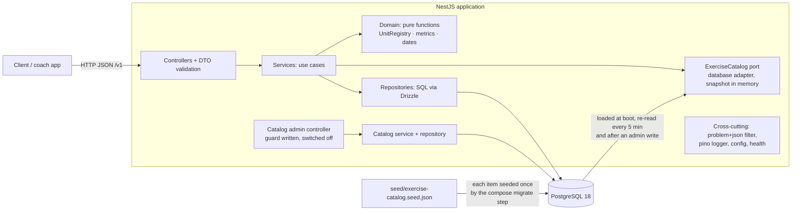

# 02 — Design: Workout Logging API

Status: **revised after debate rounds 2, 3 and 4, after reviews of the catalog refresh and of configuration and key lengths, after the owner's catalog requirement (the exercise catalog is in the database, with admin endpoints) and after the owner's time-model change (only the UTC instant is a key; the client's offset is kept for display) — all applied** · No code exists yet.

Requirement IDs (`F1`, `E5`, `V1`, `O1`…) refer to `01-requirements.md`.
Decision IDs (`D-03`…) refer to `03-decision-log.md`, where each choice has its
alternatives, reasons, evidence, outcome and "what would change my mind".
What the three debate rounds and the owner's requirement changed, and why, is
in `debate/resolution.md`. "The owner" is the candidate, as the person who
owns this project and adds a requirement of their own (`O1`).

---

## 1. Intent

Ship a take-home that a senior reviewer can run with one command, read in
twenty minutes, and trust: three features (log, history, PRs) done correctly,
with every non-obvious choice explained and measured rather than asserted.

The brief grades reasoning as much as code — "justify your choice", "explain
trade-offs", "document your strategy", and a Critical section on directing AI.
So the design favours **few moving parts, each defensible**, over breadth.

One test is applied to every rule, limit and test case below: **who sends
this, how often, and what do they see?** Inputs nobody produces do not earn
code.

## 2. Goals, non-goals, anti-goals

**Goals**

- G1. Log one or many entries; store original weight + unit and the kg value (F1).
- G2. History with partial-name, date-range and muscle-group filters, any output unit, cursor pagination (F2).
- G3. PRs (heaviest set, highest-volume set, best e1RM) with dates, plus period comparison (F3).
- G4. One structured error format; "no data" is a 200 (E1–E3).
- G5. Hot endpoints stay fast at 50,000+ entries per user, **shown by a benchmark** (E6).
- G6. A new unit = one line of code; the exercise → muscle-group mapping = data in the database (X1, X2).
- G7. `docker compose up` gives a working, documented API with the exercise catalog migrated and seeded (D3). Benchmark workout data is opt-in (`--profile bench`), so a plain `up` starts in seconds and reviewers begin from an empty log.
- G8. An honest `AI_WORKFLOW.md` and an iterative git history (AI1–AI7).
- G9. A reviewer's first request works: body `userId`, `"unit": "lbs"` and a hand-typed date either succeed or get a 400 that says exactly how to fix the request.
- G10. The catalog is maintained without a developer: exercises and muscle groups are added, corrected and removed through admin endpoints, with no code change and no deploy (the owner's requirement, O1; D-07, D-27).

**Non-goals (v1)** — auth (which leaves the catalog's write endpoints **open
to anyone**; §10.7 says so and shows the two lines that close them),
edit/delete of entries, a users table, coach↔client modelling, rate limiting,
metrics/tracing, a frontend or admin screen.

**Anti-goals** — things that make it a failure even if it runs:

- One giant commit, or AI output committed unread.
- Architecture ceremony (CQRS, event sourcing, hexagonal ports everywhere) for three use cases.
- Performance claims without a measurement.
- Invented "AI was wrong" anecdotes in `AI_WORKFLOW.md`. Only real ones.
- Silent data changes: dropping a "duplicate" the user meant to log, or drifting `225 lb` to `224.99 lb`.
- Code or tests for inputs no client or lifter produces.

## 3. Stack (versions verified against the registries, see `05-research-notes.md`)

| Layer | Choice | Decision |
|---|---|---|
| Runtime | Node.js 26 LTS ("Lithium"), TypeScript 6.0.x (**not** 7.x) | D-01 |
| Framework | NestJS 12, Express adapter, default CLI template | D-02 |
| Database | PostgreSQL 18 | D-03 |
| Data access | Drizzle ORM 0.45.x + `pg` for queries; hand-written SQL migration files | D-04 |
| Validation | `class-validator` + `class-transformer` via global `ValidationPipe` | D-05 |
| Decimal math | `decimal.js` at the conversion boundary | D-08 |
| Dates | `Temporal` (built into Node 26) — parsing only; the server resolves no time zone | D-09 |
| Ids | `uuid` 14.x, `v7()` — generated in the application | D-20 |
| Logging | `nestjs-pino` (JSON, request id) | D-23 |
| Tests | Jest 30 + `ts-jest`, Supertest, Testcontainers (real PostgreSQL), `fast-check` | D-22 |
| Docs | `@nestjs/swagger` (OpenAPI at `/docs`) | D-23 |
| Helpers | Node built-ins; `lodash` where a built-in is easier to misuse (`isPlainObject`, `get` on an `unknown` value) | D-28 |

**Libraries before hand-written code** (the owner's convention, D-28). Stable,
clean code and sound error handling decide: a function is taken from a
built-in or a well-kept library before it is written, and lodash is used
where the built-in is the easier one to get wrong. Hand-written code is kept
for domain logic, framework hooks and one- or two-line helpers. The one
exception is the benchmark's request loop (§11).

## 4. Architecture



Layered, not hexagonal (D-21). Dependency direction is one-way:
controller → service → (domain, repository, catalog). The domain layer has no
Nest, no I/O and no database types, so every calculation is a plain unit test.
Abstractions exist only where the brief asks for extensibility:
`UnitRegistry` (X1) and `ExerciseCatalog` (X2), both injected by token. The
catalog has one more short path of its own — admin controller → catalog
service → repository → the catalog tables (§10).

```
src/
  main.ts, app.module.ts
  config/            env schema + typed config (operational settings only)
  common/            problem-details filter, cursor codec, request-id, pipes, limits.ts (input caps as constants),
                     admin-token.guard.ts (written and tested; not applied in v1)
  cli/               migrate.ts — the compose `migrate` step: one lock, the migrations, then the catalog seed (§10.3);
                     compiled with the app and run as `node dist/cli/migrate.js`
  database/          drizzle provider, schema.ts (query types), migrations/*.sql (hand-written)
  units/             weight-units.ts (the one list), UnitRegistry, GET /units
  exercises/         exercise-key.ts (`exerciseKey()` and `muscleGroupName()`, the only two normalising functions;
                     used by logging, the history filter, catalog writes and the seed),
                     ExerciseCatalog port + database adapter (snapshot in memory), catalog service + repository,
                     catalog-seed.ts (the seed, called by cli/migrate.ts),
                     public controller (GET /exercises, /exercises/{key}, /muscle-groups),
                     catalog-admin.controller.ts (the five write routes; the two guard lines are here)
  workouts/          DTOs, controller, service, repository, domain/ (metrics, dates, entry factory)
  personal-records/  controller, service, repository, domain/ (delta)
  health/
seed/exercise-catalog.seed.json   the catalog's initial content — a seed, not the source of truth
scripts/             bench-data.ts (benchmark data, opt-in), bench.ts — development tools, not in the runtime image
requests.http        every call shown in the README, runnable
test/                integration (Testcontainers) + helpers
```

## 5. Data model (D-06, D-07, D-08, D-09, D-20, D-27)

Two tables hold workouts. Four small tables hold the exercise catalog
(further down). No derived columns for PRs.

```sql
-- One exercise performed at one moment by one user. Append-only in v1.
CREATE TABLE workout_entries (
  id            uuid           PRIMARY KEY DEFAULT uuidv7(),  -- supplied by the application (UUIDv7, in input order);
                                                              -- the default serves the benchmark-data seed and manual inserts
  user_id       text           NOT NULL CHECK (char_length(user_id) BETWEEN 1 AND 64),
  exercise_name text           NOT NULL,                      -- as entered (trimmed)
  exercise_key  text           NOT NULL                       -- normalised: NFKC, trim, collapse spaces, lowercase;
    CHECK (char_length(exercise_key) BETWEEN 1 AND 100),       -- the bound the application checks first (§10.1).
                                                              -- NOT a foreign key to the catalog (§10.6)
  performed_at  timestamptz(3) NOT NULL,                      -- the instant, UTC, to the millisecond; every filter, the
                                                              -- sort and the cursor use it (§8)
  utc_offset_minutes smallint  NULL                           -- the offset the client wrote, display only: 420 for +07:00;
    CHECK (utc_offset_minutes BETWEEN -720 AND 840),           -- NULL for Z or -00:00; never filtered, sorted or indexed (§8)
  created_at    timestamptz    NOT NULL DEFAULT now()
);

CREATE TABLE workout_sets (
  entry_id   uuid           NOT NULL REFERENCES workout_entries(id) ON DELETE CASCADE,
  set_number smallint       NOT NULL CHECK (set_number >= 1),
  reps       integer        NOT NULL CHECK (reps >= 1),
  weight     numeric(9,3)   NOT NULL CHECK (weight >= 0),         -- the original number, as sent
  unit       text           NOT NULL,                             -- canonical unit code; no enum/check (D-08)
  weight_kg  numeric(17,11) NOT NULL CHECK (weight_kg >= 0),      -- weight × kgPerUnit, exact: never rounded on write (§6)
  PRIMARY KEY (entry_id, set_number)
);
```

Notes:

- **Sets are the only source of truth for PRs.** Records are found by joining
  entries to sets at read time (§9.3). The round-1 design stored three
  per-entry maxima (`max_weight_kg`, `max_volume_kg`, `max_e1rm_kg`); they are
  now the *measured fallback* in §11, added only if the join misses its
  budget (D-06).
- **Entries hold no reference to the catalog.** The catalog is in the
  database (below, §10), but an entry carries only its own `exercise_key`.
  Unknown exercises stay loggable (F2.3 says "if exercise metadata is
  available"), deleting a catalog exercise cannot orphan or block anything,
  and correcting a catalog exercise fixes old entries too, because muscle
  groups are resolved by key at read time.
- **A key is 1–100 characters, checked twice** (the owner's decision).
  Normalising can lengthen a name — one character, U+FDFA, becomes 18 —
  so a name that passes the 1–100 rule can give a key of 1 800 (V-21). The
  application checks the key itself after normalising, so such a name is a
  400 naming the field (§10.1). The `CHECK` matches the catalog's
  `exercises.exercise_key` and catches what skips the application: the
  benchmark data and SQL typed by hand. It bounds length only, in code
  points as `char_length` counts them; it does not repeat the
  normalisation rule (§10.1).
- **One instant per entry is the only time key.** `performed_at` is a
  `timestamptz`, which stores an exact moment; a plain `timestamp` would
  silently drop the offset and read back differently on machines in
  different zones (§8). `utc_offset_minutes` records where the athlete was,
  for display only; no filter, sort, index or cursor reads it.
- `weight` is the number the client sent; it comes back in `original`, with
  the canonical unit code, and as the weight itself when the caller asks for
  the set's own unit — so there is never round-trip drift.
- There is no `set_count` column (round 2): nothing read it, and the sets are
  loaded with the entry anyway.

### Catalog tables (D-07, D-27)

They arrive in a second migration, with the catalog slice (§15).

```sql
-- The closed list of muscle groups. A new group is one admin call (§10.5).
CREATE TABLE muscle_groups (
  name        text PRIMARY KEY CHECK (char_length(name) BETWEEN 1 AND 40),  -- lowercase
  created_at  timestamptz(3) NOT NULL DEFAULT now()
);

CREATE TABLE exercises (
  exercise_key  text PRIMARY KEY CHECK (char_length(exercise_key) BETWEEN 1 AND 100),  -- same function as
                                                                                       -- workout_entries.exercise_key
  name          text NOT NULL CHECK (char_length(name) BETWEEN 1 AND 100),             -- display spelling
  created_at    timestamptz(3) NOT NULL DEFAULT now(),
  updated_at    timestamptz(3) NOT NULL DEFAULT now()
);

CREATE TABLE exercise_muscle_groups (
  exercise_key  text     NOT NULL REFERENCES exercises (exercise_key) ON DELETE CASCADE,
  muscle_group  text     NOT NULL REFERENCES muscle_groups (name),    -- NO ACTION, the default (note below)
  position      smallint NOT NULL,          -- the order given on the write (primary mover first)
  PRIMARY KEY (exercise_key, muscle_group)
);

-- Which items of seed/exercise-catalog.seed.json this database has already been given (§10.3).
CREATE TABLE catalog_seed_ledger (
  kind       text NOT NULL CHECK (kind IN ('exercise', 'muscle_group')),
  item_key   text NOT NULL,
  seeded_at  timestamptz(3) NOT NULL DEFAULT now(),
  PRIMARY KEY (kind, item_key)
);
```

- The group's foreign key keeps the default action, `NO ACTION`, which stops
  a group that an exercise still lists from being deleted, so tags are never
  lost silently. The database answers with a foreign-key error (`23503`);
  the group-delete route maps it to 409 `MUSCLE_GROUP_IN_USE` (§10.5).
  `ON DELETE RESTRICT` refuses the same delete but answers `23001`
  (`restrict_violation`, checked on PostgreSQL 18.7, V-20), which that
  mapping would miss: a 500 on a documented 409.
- No secondary index on these tables: they hold hundreds of rows and are read
  whole into memory (§10.2).
- There is no database `CHECK` that re-implements the key normalisation; §10.1
  says why. The length checks are not that: they bound the stored values,
  which the application measures after normalising (§10.1).

### Indexes

| Index | Serves |
|---|---|
| `ix_entries_history (user_id, performed_at DESC, id DESC) INCLUDE (exercise_key)` | History default order + keyset pagination + date range. `INCLUDE` lets the partial-name and muscle-group filters be evaluated from the index without touching the heap — **only because the history query is two-step** (ids first, rows second; see §9.2 and D-16). |
| `ix_entries_exercise (user_id, exercise_key, performed_at DESC, id DESC)` | The entry side of the PR join: one range scan per period, read from the index alone. History has no exact-exercise filter in v1; besides PRs, this index is what the history fallback in §11 would walk if the name filter misses its budget. |
| `workout_sets` PK `(entry_id, set_number)` | The set side of the PR join; loading sets for a page of entries. Sets of one entry are inserted together, so they sit next to each other on disk. |

Two secondary indexes on the write-hot table; that is the whole indexing
budget. No trigram index, no stored maxima, no per-metric PR indexes — see
D-11 and D-16 for why, and §11 for the benchmark that must confirm it. The
catalog tables are not write-hot and have only their primary keys.

## 6. Units (D-08, D-24)

```ts
// src/units/weight-units.ts — the ONLY place a unit is defined
export const WEIGHT_UNITS = [
  { code: 'kg', label: 'Kilogram', kgPerUnit: '1',          aliases: ['kgs'] },
  { code: 'lb', label: 'Pound',    kgPerUnit: '0.45359237', aliases: ['lbs'] },   // exact by definition (1959)
  // { code: 'st', label: 'Stone', kgPerUnit: '6.35029318', aliases: ['stone'] }, // adding stone = this line
] as const;
```

`UnitRegistry` (injectable) exposes `resolve(input)`, `codes()`,
`toKg(value, code)`, `fromKg(kg, code)`. The DTO validator, the OpenAPI
description, the error message listing supported units and `GET /v1/units`
all read from it. In OpenAPI, `unit` on input is a case-insensitive string
whose description lists the accepted spellings; on output it is an enum of
the canonical codes — an input enum would tell a generated client that
`lbs` is invalid when it is not.
The database stores the unit as text with no enum or CHECK, so adding a unit
needs no migration.

**Spelling.** `resolve` trims, lower-cases and matches the code or an alias,
so `lb`, `LB`, `lbs`, `Lbs`, `kg`, `KG`, `Kg` and `kgs` are all accepted on
input and in the `unit` query parameter. "lbs" is the everyday spelling; a
first request answered with a 400 for it would be a self-inflicted wound. The
**canonical code** (`lb`, `kg`) is what is stored and what every response
returns.

Arithmetic uses `decimal.js`, never binary floats: `weight_kg = weight × kgPerUnit`,
**stored exactly and never rounded on write**. An accepted weight has at most
three decimals (§9.1) and a factor at most eight, so the product has at most
eleven: the column is `numeric(17,11)`, and a registry test fails if a factor
with more than eight decimals is ever added. `225 lb` is stored as
`102.05828325`. Rounding happens once, when a value is displayed.

`decimal.js` is set to 40 significant digits at startup
(`Decimal.set({ precision: 40 })`). The largest product the ranking forms —
the heaviest accepted weight in the unit with the largest factor, times
thirty reps plus one — has 18, and the library's own default is 20 (recalled);
40 removes the question, and the registry test asserts the setting. A
decimal is built from the number's shortest text form
(`new Decimal(String(n))`), and the three-decimal check of §9.1 is made on
that text. Every accepted weight, 0.000 to 10 000.000, comes back from
`JSON.parse` exactly as typed (checked, `05-research-notes.md`), so no
accepted input is changed on the way in.

Why exact (round 2; this reverses the four-decimal rule kept after round 1):
rounding each set to four decimals of a kilogram breaks true ties between
ordinary pound sets. `100 lb × 10` and `200 lb × 5` are both 1 000 lb of
volume, but rounded first they become 453.5920 and 453.5925 kg, so the later
workout takes the record from the earlier one. `200 lb × 5` and
`175 lb × 10` tie on estimated 1RM and split the same way. Anyone who trains
in pounds produces such pairs with ordinary plates, and the tie-break rule
(§7 — the earliest instant keeps the record) cannot work on numbers that are no
longer equal. Exact products keep equal lifts equal. All derived values are
computed from the **stored** `weight_kg`, so anything shown can be reproduced
from the database.

Output: values are converted to the requested unit and rounded half-up to 2
decimals, at display only. Every set also carries `original: { weight, unit }`
— the number as sent and the canonical unit code (`"lbs"` comes back as
`"lb"`). When the requested unit is the set's own unit, the original number
is the weight returned. So an original comes back as sent, with up to three
decimals, and everything computed has two: `100.125 kg × 1` shows
`weight: 100.125` and `volume: 100.13`. The README says so in one sentence.

With exact kilograms a pound set's volume shown back in pounds is exact too
(`6 lb × 50` is 300; the four-decimal design showed 300.01).

## 7. Calculations (D-11, D-12)

Pure functions in `workouts/domain/metrics.ts`:

- `volumeKg(set) = reps × weight_kg`
- `e1rmKg(set) = weight_kg × (1 + reps/30)` — the brief's Epley formula, **for
  every rep count including 1**. Computed as `weight_kg × (30 + reps) / 30`
  and rounded only when displayed.
- `rank(metric, set)` → the exact score used for ordering: `weight_kg`,
  `weight_kg × reps`, `weight_kg × (30 + reps)`. No division, no rounding, so
  ranking in SQL and in TypeScript cannot disagree.

The 1RM figure is an **estimate** and is called one everywhere it appears:
field names, the OpenAPI descriptions and the README say "estimated 1RM",
never "your 1RM".

**One rep.** `100 kg × 1` reports an estimated 1RM of 103.33 kg, as the brief's
formula gives. The round-1 design returned the weight itself at one rep; that
exception was rejected (D-12) because the brief is the specification being
graded and the two rules crown different workouts — `100 kg × 1` against
`96 kg × 2` is 103.33 against 102.40 under the brief's formula, so the single
holds the record. The README says plainly that Epley overestimates a true
single by 3.3 %, that its own source states it for more than one rep, and
that the exception is a small change — one line in the domain function and
the matching expression in the PR query — because nothing derived is stored.

**PR tie-break:** highest score, then earliest `performed_at`, then lowest
`id`, then lowest `set_number` — "the moment the PR was first achieved". A later lift that merely equals the record does not move
the date. Two fixed tests hold this for real pound ties (§6): `100 lb × 10`
then, on a later day, `200 lb × 5` — the first keeps the volume record;
`200 lb × 5` then `175 lb × 10` — the first keeps the estimated-1RM record.
The instant is the one the client sent; when the client did not know the
time and chose one (§8), the tie-break uses that choice like any other.

The ranking expressions exist twice — in the PR query (§9.3) and in
`rank()`. They are three multiplications. A **fixed fixture, never cut**
(§16), runs both over the same sets and asserts that they pick the same entry
and the same set for all three records: `100 kg × 1` against `96 kg × 2`;
equal scores on two dates; a kilogram set against a pound set; a zero-weight
set. Generated sets (`fast-check`) widen the same check and can be dropped if
time runs short; the fixed fixture cannot.

## 8. Time (D-09, D-13)

**One moment per entry, plus where the athlete was.** Every entry stores
when it happened as a UTC instant, `performed_at timestamptz(3)`; that is
the only value any filter, sort, index or cursor uses. Next to it,
`utc_offset_minutes` keeps the offset the client wrote, for display only.
Days, weeks and months are cut by the caller: it turns them into instants in
whichever zone it chooses, and the server compares instants. The server
takes no zone and never asks the database for one.

Why, in the case that settled it — an athlete who trains in Vietnam and
flies to the US the same day:

| Sent as `date` | Stored instant | Stored offset | A viewer in Vietnam (UTC+7) sees | A viewer at UTC−7 sees |
|---|---|---|---|---|
| `2025-02-10T05:30:00+07:00` | `2025-02-09T22:30:00.000Z` | `420` | Feb 10, 05:30 | Feb 9, 15:30 |
| `2025-02-10T20:30:00-07:00` | `2025-02-11T03:30:00.000Z` | `-420` | Feb 11, 10:30 | Feb 10, 20:30 |

The two workouts are 29 hours apart. The design of rounds 1–3 stored the
athlete's local date and filed both under Feb 10, so a date range could not
tell them apart and no viewer's timeline matched the stored days. With the
instant as the only key, every viewer gets one consistent timeline in their
own zone (V-17); with the offset beside it, any viewer can also be shown
the athlete's own clock: "Feb 10, 05:30 (UTC+7)".

**Why `timestamptz` and not `timestamp`.** Despite the names, neither
PostgreSQL type stores a zone. `timestamptz` stores an exact moment: input
with an offset is converted to UTC, and output is the same moment whatever
the reader's zone. `timestamp` stores a wall-clock reading with no place
attached, and **silently drops an offset** written in its input, so
`2025-02-10T05:30:00+07:00` would be stored as 05:30 with nothing to say
where (V-19). It also comes back through `node-postgres` as a `Date` read
in the Node process's local zone (V-9), so the same row would mean
different moments on a UTC container and on a developer's machine in Hanoi.
Both types take 8 bytes. `datetime` is not a PostgreSQL type (it is
MySQL's, and behaves like `timestamp` there); a `bigint` of epoch
milliseconds saves nothing and loses readable values and date functions; a
`text` ISO string sorts correctly only if every value has the same format
and offset. Because `timestamptz` keeps the moment and drops the offset,
the offset needs its own column.

**What `date` accepts** on a write: one format — an RFC 3339 date-time with
`Z` or an offset. Some ISO 8601 variants of it are tolerated (below).

| Client sends `date` | Stored `performed_at` | Stored `utc_offset_minutes` | Response |
|---|---|---|---|
| `2025-02-10T05:30:00+07:00` | `2025-02-09T22:30:00.000Z` | `420` | `"date": "2025-02-09T22:30:00.000Z", "utcOffset": "+07:00"` |
| `2025-02-10T12:30:00Z` | `2025-02-10T12:30:00.000Z` | `NULL` | `"date": "2025-02-10T12:30:00.000Z", "utcOffset": null` |
| `2025-02-10T12:30:00+00:00` | `2025-02-10T12:30:00.000Z` | `0` | `"utcOffset": "+00:00"` |
| `2025-02-10T12:30:00.123456Z` | `2025-02-10T12:30:00.123Z` — cut to the millisecond | `NULL` | the stored instant |
| `2025-02-10T06:30:00+07:00[Asia/Ho_Chi_Minh]` | `2025-02-09T23:30:00.000Z` | `420` | the bracket is ignored |
| `2025-02-10` (a date alone) | — | — | **400**: no time or offset |
| `2025-02-10T06:30:00` (no offset) | — | — | **400**: no offset |
| an offset outside −12:00…+14:00, or not a whole number of minutes | — | — | **400** |
| a number such as `1739165400000` | — | — | **400**: the field is a string |

- **The offset is kept for display, never for logic** (the owner's
  decision after round 4). It is read from the text the client sent:
  `+07:00` → `420`, `-07:00` → `-420`, `+05:45` → `345`, `+00:00` → `0`.
  `Z` and `-00:00` mean "UTC known, local offset unknown" (RFC 9557, K-18),
  so they are stored as `NULL` — which is what every JavaScript client
  sending `toISOString()` produces. Responses carry it as `utcOffset`
  (`"+07:00"` or `null`). It lets a client show a workout at the athlete's
  local time, and lets a later version build an athlete-day view from
  history already logged; it cannot go stale, because it records where the
  athlete was at that moment, not where they live. Real offsets run from
  UTC−12:00 to UTC+14:00 in whole minutes; anything else is a 400, and a
  `CHECK` on the column says the same. A `null` offset is the common case,
  not an error: that workout is shown in the viewer's zone, as it was
  before the offset was kept. A client that wants the athlete's clock shown
  sends its local offset instead of `Z`, and the README gives the one line:
  `Temporal.Now.zonedDateTimeISO().toString({ smallestUnit: 'millisecond',
  timeZoneName: 'never' })`, which prints `…T05:30:00.000+07:00` in Hanoi;
  without `Temporal`, the offset in minutes is
  `-new Date().getTimezoneOffset()` (the method counts minutes behind UTC)
  (V-19).
- **A zone in brackets is accepted and ignored** (the owner's decision).
  RFC 9557 lets a timestamp carry a zone name after the offset, and
  `Temporal.ZonedDateTime.prototype.toString()` and Java's
  `ZonedDateTime.toString()` print one by default (V-18). The offset decides
  the instant and is stored; the bracket is stored nowhere. A bracket that
  contradicts its offset (`+07:00[America/Denver]`) passes too, read by its
  offset — only a broken client sends one.
- **One format, and the client chooses any time it does not know** (the
  owner's decision). A date alone or a date-time with no offset is a 400.
  Real input sometimes knows only the day — a session back-filled from a
  notebook, a coach entering a week from a spreadsheet, an imported history
  — and the client is the right place to fill in a time, because it knows
  the athlete's zone and the server does not. The README recommends **noon
  in the athlete's own offset for a past day, and the current time for
  today if noon has not come yet** (noon would be in the future and
  refused, below). Noon keeps the athlete's own day; a viewer more than
  twelve hours away still sees a neighbouring day — noon `+07:00` is 21:00
  the previous day in Los Angeles (V-18). Midnight UTC, the time an
  importer reaches for, puts the entry on the previous day for every viewer
  in the Americas; the README says so. The cost, accepted: a time the client
  invented cannot be told from a real one.
- **Two messages, each showing the fix.** The likely first request, given
  the field's name, is `"date": "2025-02-10"`: "'2025-02-10' has no time or
  UTC offset, so the moment it names is unknown. Add the time and your UTC
  offset, for example 2025-02-10T09:00:00+07:00. Z means UTC, not your
  local time." A date-time with no offset (a hand-typed curl, Python's
  `isoformat()` on a naive value, an HTML `datetime-local` field) gets "'…'
  has no UTC offset, so the moment it names is unknown. Add your UTC offset,
  for example …+07:00. Z means UTC, not your local time." The last sentence
  is there because putting `Z` after a local time is the mistake that cannot
  be caught later. Every example in the README, `requests.http` and the
  OpenAPI document uses a full date-time.
- **One parser.** `Temporal.Instant.from(text)`, cut to the millisecond. It
  throws on a date alone, on a date-time with no offset and on a date that
  does not exist (`2025-02-30T09:00:00Z`), and each becomes a 400 with its
  path, not a database error. `Temporal` also accepts a space instead of
  `T`, lower-case `t` and `z`, an offset written `+07` or `+0700`, the
  compact `20250210T053000Z`, and reads a leap second `:60` as `:59` (V-17);
  all are kept, since each names one instant without doubt. They are ISO
  8601 but not RFC 3339, so the OpenAPI text says "RFC 3339; some ISO 8601
  variants are tolerated".
- **Bounds on a write.** An instant later than **now + 15 minutes** is a
  400. Phone clocks are off by seconds, not minutes. The bound also catches
  a local wall time sent with `Z` east of UTC — but only when the entry is
  logged within a few hours of the workout: a Vietnam 20:00 session sent as
  `20:00Z` at 21:00 local is six hours ahead and refused, while the same
  mistake logged the next evening is in the past and accepted (V-18). West
  of UTC the mistake always lands in the past. The message names that
  likely cause and shows the server's time; the README states both limits.
  **Lower bound: `1900-01-01T00:00:00Z`.** It is a typo guard — nobody's
  training predates it, and a year typed short (`0225`) is a mistake — and
  it also keeps far-past values away from the database: `Temporal` accepts
  years down to −271821, PostgreSQL's range starts at 4713 BC (V-19). "Now"
  comes from an injected clock, so tests fix it.
- **Reads take instants.** `from` / `to` on history and PRs, and the four
  bounds of compare, are date-times with `Z` or an offset forming a
  half-open range `[from, to)`: **`from` is included, `to` is not**, and the
  OpenAPI text, the 400s and the compare message all say so. February for a
  viewer in Hanoi is `from=2025-01-31T17:00:00Z&to=2025-02-28T17:00:00Z`
  (the same as `…T00:00:00+07:00`); one period's `to` is the next one's
  `from`, so consecutive periods never overlap or leave a gap. Each bound is
  usable alone. A date alone is a 400 that shows what to send, and the
  advice depends on the bound: on `to`, "to include all of 2025-02-28, send
  the start of the next day, for example 2025-03-01T00:00:00+07:00"; on
  `from`, "to start at 2025-02-01, send the start of that day, for example
  2025-02-01T00:00:00+07:00" (the `to` advice would drop a day there). A
  date-time with no offset is a 400 as on writes. Read bounds have the same 1900 floor as writes and no upper
  limit. Both bounds are **rounded up** to the next millisecond when they
  carry finer digits — for stored millisecond values that gives exactly
  `from <= performed_at < to` (V-18) — and `from >= to` is checked after
  rounding, since a half-open range with equal ends is empty. Compare
  accepts overlapping periods; each is answered on its own.
- **A `+` in a query string arrives as a space.** `from=…T00:00:00+07:00`
  reaches the server as `…T00:00:00 07:00` (V-17) — the likely failure of a
  reviewer's first ranged curl. After a time, a space followed by an offset
  in any accepted form (`07`, `0700`, `07:00`, after `T`, `t` or a space)
  has no other meaning, so it is read as `+`. The repair runs on the parsed
  query before validation; a unit test covers each form, and the
  first-request integration test sends one unencoded `+07:00` range through
  the app (U-22). `%2B` and `Z` work as they are.
- **The caller chooses the zone a period is cut in** (A6). A viewer's own
  "this month" is cut in the viewer's zone; a coach looking at a client
  would normally want the client's zone, which no caller can know in v1
  without a profile — out of scope under T4. Meanwhile `utcOffset` lets a
  client show each entry at the athlete's local time. The README gives the
  recipe for bounds: a `Temporal.ZonedDateTime` at the start of the period,
  `.add({ months: 1 })` or `.add({ weeks: 1 })`, then
  `.toInstant().toString()`, which prints `Z` with no `+` to encode — never
  a fixed number of hours. A week that starts on 2025-03-09 in Los Angeles
  is 167 hours long; adding 168 hours ends it at 01:00, and a 00:30 workout
  on the next Sunday falls into the wrong week (V-17).
- **Daylight saving does not touch the write path**: the server never turns
  a wall time into an instant. It enters only through the caller's bounds.
  What the server owns is the boundary itself, and an integration test
  holds it: entries at `from − 1 ms`, `from`, `to − 1 ms` and `to` across two
  adjacent periods each appear in exactly one, on history, PRs and compare.
- **Implementation rules.** No query uses the database session's zone — no
  cast of a `timestamptz` to a date, no `date_trunc`, no `current_date`;
  instants are compared as instants. `node-postgres` reads `performed_at`
  as an exact JavaScript `Date`, because `timestamptz` arrives with its
  offset; the response prints it with `toISOString()`, so a response never
  depends on the server's zone. Values are cut to the millisecond in the
  application before they are written, so the 201 body shows exactly what
  was stored — PostgreSQL would round extra digits rather than cut them
  (V-19). The test suite runs with `TZ=Asia/Ho_Chi_Minh` and the test
  database's session zone set to `America/Los_Angeles`: Docker runs in UTC
  on both sides and would hide offset-less text parsed in the process's
  zone, or a cast through the session's zone.
- **Sort order** is `performed_at DESC, id DESC`. Ids are UUIDv7 generated
  in the application in input order. Two different orders follow, and both
  are stated: the **bulk response** lists entries in the order they were
  sent; **history** is newest first, so entries with the same instant come
  back newest id first — for one bulk request, the reverse of the order
  sent. This is the common case, not an edge: a session of 5–12 exercises is
  usually logged once with one time, so history lists it last exercise
  first, and the README tells a client to reverse entries that share a
  `date` to show a session in order. A mixed-direction order would lose the
  row-value comparison the keyset depends on. An integration test posts two
  entries with the same `date` in one request, asserts the response keeps
  the order sent, then walks two history pages of size one and asserts the
  reverse order and that each id still carries its own sets.
- Trade-offs to write up in the README: periods are cut in a zone the
  caller chooses, and with no athlete profile in v1 a coach in another zone
  sees a workout on the day it fell in the coach's zone (a 06:00 Monday
  session in Hanoi is Sunday 15:00 in Los Angeles in winter, 16:00 in
  summer), while `utcOffset` still shows the athlete's own clock; an
  athlete-day view built on the stored offset is the next step; a date
  alone is refused, and a client that knows only the day chooses the time;
  the caller computes period bounds, and `to` is excluded; the future bound
  catches a local time sent with `Z` only east of UTC and only when logged
  soon; there is no user-settings table, because a stored zone would be a
  second source of truth that goes stale exactly when the user travels.

## 9. API (D-10, D-14, D-15, D-17, D-18, D-19, D-27)

Base path `/v1`. Request bodies are JSON only; any other media type on a
route that takes a body is a 415, and parameters such as `charset` are
ignored (§9.6). `userId` is a path segment: an
opaque string, 1–64 chars of `[A-Za-z0-9_.-]`.

On the four routes that read query parameters (history, one entry, PRs and
compare), a parameter the route does not accept is a 400 that names it and
lists the accepted ones, and a parameter sent twice is a 400. Otherwise
`?exerciseName=bench` (the body's field name) or `?page=2` would return the
unfiltered list, which reads as an answer; the same reasoning rejects
unknown body properties (D-18). The catalog and unit routes read no
parameters.

| Method | Path | Purpose | Success |
|---|---|---|---|
| POST | `/users/{userId}/workout-entries` | Log one entry | 201 + `Location` |
| POST | `/users/{userId}/workout-entries/bulk` | Log 1–100 entries atomically | 201 |
| GET | `/users/{userId}/workout-entries` | History | 200 |
| GET | `/users/{userId}/workout-entries/{id}` | One entry (target of `Location`) | 200 / 404 |
| GET | `/users/{userId}/personal-records` | PRs for one exercise | 200 |
| GET | `/users/{userId}/personal-records/compare` | PRs in two periods + delta | 200 |
| GET | `/exercises` | The catalog: every exercise with its muscle groups | 200 |
| GET | `/exercises/{exerciseKey}` | One catalog exercise | 200 / 404 |
| GET | `/muscle-groups` | The known muscle groups | 200 |
| GET | `/units` | Supported units and their aliases | 200 |
| POST | `/admin/exercises` | Add a catalog exercise | 201 + `Location` / 409 |
| PUT | `/admin/exercises/{exerciseKey}` | Replace its spelling and muscle groups | 200 / 404 |
| DELETE | `/admin/exercises/{exerciseKey}` | Remove it from the catalog; logged entries are not touched | 204 / 404 |
| POST | `/admin/muscle-groups` | Add a muscle group | 201 / 409 |
| DELETE | `/admin/muscle-groups/{name}` | Remove a muscle group no exercise uses | 204 / 404 / 409 |
| GET | `/health/live`, `/health/ready` (unversioned) | Liveness / DB readiness | 200 / 503 |
| GET | `/docs` (unversioned) | Swagger UI | 200 |

> **The five `/admin` routes are unauthenticated in v1: anyone who can reach
> the API can change the catalog.** That is the owner's decision for this
> version. The guard is written and tested, and two commented-out lines
> switch it on (§10.7).
> The catalog contract is in §10; the rest of this section is the workout API.

### 9.1 Log an entry

```http
POST /v1/users/u_123/workout-entries

{ "date": "2025-02-10T05:30:00+07:00",
  "exerciseName": "Bench Press",
  "sets": [ { "reps": 5, "weight": 225, "unit": "lbs" },
            { "reps": 3, "weight": 105, "unit": "kg" } ] }
```

```json
201
{ "data": {
    "id": "0194f2fe-…", "userId": "u_123",
    "exerciseName": "Bench Press", "exerciseKey": "bench press",
    "muscleGroups": ["chest", "shoulders", "triceps"],
    "date": "2025-02-09T22:30:00.000Z", "utcOffset": "+07:00",
    "sets": [
      { "setNumber": 1, "reps": 5, "weight": 102.06, "unit": "kg", "original": { "weight": 225, "unit": "lb" } },
      { "setNumber": 2, "reps": 3, "weight": 105,    "unit": "kg", "original": { "weight": 105, "unit": "kg" } } ],
    "createdAt": "2025-02-11T03:12:45.120Z" } }
```

A workout at 05:30 in Vietnam comes back with the previous UTC day in
`date`, and `utcOffset` says where it was logged. The OpenAPI text for
`date` says it is an instant to be shown in a zone, and that its first ten
characters are not a local date; the text for `utcOffset` says it is for
display only and is `null` when the client sent `Z`.

Bulk body: `{ "entries": [ <same shape>, … ] }` → `{ "data": [ … ] }` in the
order sent (history lists them newest first — §8). One transaction; if any
entry is invalid nothing is stored.

**Every problem of a request comes back in one response.** The field rules
of the DTOs and the cross-field rules — the body `userId` against the path
among them — are collected and returned together in one `errors[]`,
each with its path (`entries[2].sets[0].unit`), so a client fixes a request
in one round instead of one error at a time. A cross-field rule still runs
when another field of the same item has failed; it is skipped only when a
field it reads is itself invalid. One bulk test sends an unsupported unit in
one item, a date-time with no offset in another and a body `userId`
that differs from the path in a third, and asserts all three errors and zero
rows written.

**Body shape.** The single endpoint takes one object and `/bulk` takes
`{ "entries": [ … ] }`. An array sent to the single endpoint, or a bare array
sent to `/bulk`, is a 400 whose message shows the expected shape — the two
most likely first mistakes.

**`Location`.** The single POST returns `Location` pointing at
`GET …/workout-entries/{id}`. `/bulk` returns none: it creates many
resources and no one URL stands for them; each item carries its `id`. If
`GET …/{id}` is cut (§16), the single POST returns 201 with the entry in the
body and no `Location`.

Write mechanics: the service generates one UUIDv7 per entry, in input order,
then issues two plain multi-row `INSERT`s (entries, then sets) in one
transaction. Sets are attached to entries by the ids the application already
holds — nothing depends on the order in which PostgreSQL returns rows.

Validation rules:

| Field | Rule |
|---|---|
| `date` | required; an RFC 3339 date-time with `Z` or an offset (some ISO 8601 variants tolerated) — a date alone, or a date-time with no offset, is a 400; an offset from −12:00 to +14:00 in whole minutes; a zone in brackets is accepted and ignored; no later than now + 15 minutes; not before `1900-01-01T00:00:00Z` (§8) |
| `exerciseName` | required string; 1–100 chars after trimming, and its key (§10.1) 1–100 characters too: a name that normalising lengthens past that is a 400 on `exerciseName` |
| `sets` | required array, 1–50 items |
| `sets[].reps` | integer, 1–1 000 |
| `sets[].weight` | finite number, 0–10 000, at most 3 decimal places, checked on the number's shortest text (§6) (0 = bodyweight) |
| `sets[].unit` | a code or alias known to `UnitRegistry`, case-insensitive (§6) |
| `userId` | optional, on the entry and on each bulk item; must equal the path `userId`, else 400 naming the field |
| `entries` (bulk) | 1–100 items |
| any other property | rejected (`whitelist` + `forbidNonWhitelisted`) |

The brief lists `userId` among an entry's fields, so a reviewer's first
request will have it in the body. It is accepted when it matches the path and
is not stored twice; a different value is a 400, never silently ignored.

The caps are **constants in code** (`common/limits.ts`), not environment
settings. They are typo guards, not statements about lifting: the heaviest
barbell lifts are around 500 kg, a set is 1–30 reps, a session is 5–12
exercises. Three input decimals are needed and enough — 0.125 kg micro-plates
exist. Column widths follow from the caps: the largest accepted weight in the
heaviest unit ever likely to be added (10 000 st = 63 502.9318 kg) has five
integer digits, and `numeric(17,11)` holds six. One unit test walks the
registry and fails if a newly added unit could overflow the column or has a
factor with more than eight decimals (§6).

`reps = 0` is rejected: a failed attempt is not a set. The README says so.

### 9.2 History

`GET /v1/users/u_123/workout-entries?exercise=bench&muscleGroup=chest&from=2025-01-31T17:00:00Z&to=2025-02-28T17:00:00Z&unit=lb&limit=20&cursor=…`

(February for a viewer in Hanoi: `to` is excluded, §8.)

| Param | Rule |
|---|---|
| `exercise` | optional, 1–100 chars; case-insensitive substring of the exercise name; `%` `_` `\` are escaped |
| `muscleGroup` | optional; normalised by `muscleGroupName()` (§10.1); must be a group in the request's catalog snapshot (§10.2), else 400 listing them |
| `from`, `to` | optional date-times with `Z` or an offset; half-open — `from` included, `to` excluded; each usable alone; not before 1900; rounded up to the millisecond (§8) |
| `unit` | optional, default `kg`; code or alias |
| `limit` | 1–100, default 20 |
| `cursor` | opaque; base64url of `{ v:1, at, id }`; malformed → 400 |
| any other parameter | 400 naming it and listing the accepted ones; a parameter sent twice, or with an empty value, is a 400 too (§9) |

```json
200
{ "data": [ { …entry… } ],
  "page": { "limit": 20, "hasMore": true, "nextCursor": "eyJ2IjoxLC…" } }
```

Empty: `{ "data": [], "page": { "limit": 20, "hasMore": false, "nextCursor": null }, "message": "No workout entries found for the given filters." }` with **200** (E3).

No `total` count: counting every match on each page is the expensive part at
scale and keyset pagination does not need it.

Query plan intent (built dynamically — only the predicates actually
requested). It is **two steps on purpose**. PostgreSQL can filter on an
`INCLUDE` column without visiting the table only in an Index Only Scan, and
that requires every column the statement touches to be in the index. Step 1
therefore reads nothing but indexed columns; step 2 fetches the ≤ `limit + 1`
full rows.

```sql
-- Step 1: page of ids, index-only on ix_entries_history
SELECT e.id, e.performed_at, e.exercise_key
FROM workout_entries e
WHERE e.user_id = $1
  AND e.performed_at >= $2                                           -- if from
  AND e.performed_at <  $3                                           -- if to (half-open)
  AND e.exercise_key LIKE '%' || $4 || '%' ESCAPE '\'                -- if exercise ($4 pre-normalised + escaped)
  AND e.exercise_key = ANY($5)                                       -- if muscleGroup: keys from the catalog snapshot (§10.2)
  AND (e.performed_at, e.id) < ($6, $7)                              -- if cursor (row-value comparison)
ORDER BY e.performed_at DESC, e.id DESC
LIMIT $limit + 1;
-- Step 2: full rows  WHERE id = ANY($ids)   (primary key; re-sorted in the same order)
-- then: sets for those ids (one query). Muscle groups come from the catalog snapshot.
```

- The muscle-group filter is a list of exercise keys resolved from the
  catalog snapshot each API process holds in memory (§10.2) — no join, no
  subquery. Moving the catalog into the database did not change this query.
  A known group that no exercise uses resolves to an empty list, and the
  answer is the empty 200 with its message. The 400 for an unknown group is
  decided from the same snapshot, so the check and the key list cannot
  disagree.
- With a cursor, the row-value condition is on the index's leading columns,
  so the scan starts at the cursor instead of at the user's newest row; the
  benchmark's `EXPLAIN` confirms it.
- The cursor is built from the last row **returned**, not the look-ahead row.
  It is built from the **stored row** (`performed_at` to the millisecond,
  and `id`), never from the formatted response, so a change in how the
  response prints an instant cannot break paging. An integration test, never
  cut (§16), pages entries on different instants and entries sharing one
  instant at page size one and asserts that every entry appears exactly
  once, in order.
- A cursor is not bound to the filters it was issued with; reusing one under
  different filters is a client bug that yields an odd page, not wrong data.
- An entry back-dated while someone is paging is missed only if it sorts
  into the part of the list **already read**; one that lands below the
  cursor still appears on a later page. A reload shows everything. Both
  points get one line each in the README.

Index-only scans also depend on the visibility map, so the benchmark-data seed runs
`VACUUM (ANALYZE)` after bulk loading and the README says so; in normal
operation autovacuum maintains it for an insert-only table. Page one always
reads the newest rows, which are the ones not yet vacuumed — so the benchmark
also runs after fresh inserts (§11).

### 9.3 Personal records

`GET /v1/users/u_123/personal-records?exercise=Bench%20Press&unit=kg[&from=…][&to=…]`

`exercise` is required and matched exactly after normalisation: it must be
the **whole name**. `bench` does not find `bench press` here — a record
belongs to one exercise, and merging every name that contains a word would
invent records. (History's `?exercise=` is the filter that finds names
containing a term.) `from` and `to` are optional and each usable alone.

```json
200
{ "data": {
    "exercise": { "key": "bench press" }, "unit": "kg",
    "range": { "from": null, "to": null },
    "records": {
      "heaviestSet":      { "weight": 120, "reps": 2, "unit": "kg", "original": { "weight": 120, "unit": "kg" },
                            "date": "2025-01-02T11:05:00.000Z", "utcOffset": "+07:00",
                            "entryId": "0194…", "setNumber": 3 },
      "highestVolumeSet": { "volume": 1000, "weight": 100, "reps": 10, "…": "same fields" },
      "bestEstimatedOneRepMax": { "estimatedOneRepMax": 133.33, "weight": 100, "reps": 10, "…": "same fields" } } } }
```

Nothing found → 200, all three records `null`, plus a `message` (E3). The
message is fixed text, the same whether the name or the date range was the
reason, so no second query is spent finding out which:

> No entries found for exercise 'bench' in this range. This filter matches
> the whole exercise name; `GET /v1/users/{userId}/workout-entries?exercise=bench`
> lists the names that contain it.

Someone who typed half a name therefore learns in one response why the
answer is empty and where to look. The message quotes the key — the name as
normalised, which is what was searched for — and compare's message does the
same (§9.4).

Query: the join is evaluated once and materialised; each of the three picks
reads that result.

```sql
WITH scoped AS MATERIALIZED (
  SELECT e.id, e.performed_at, s.set_number, s.reps, s.weight_kg
  FROM workout_entries e
  JOIN workout_sets s ON s.entry_id = e.id
  WHERE e.user_id = $1 AND e.exercise_key = $2
    AND e.performed_at >= $3                                         -- if from
    AND e.performed_at <  $4 )                                       -- if to (half-open)
(SELECT 'weight' AS record, id, set_number FROM scoped
   ORDER BY weight_kg DESC,               performed_at, id, set_number LIMIT 1)
UNION ALL
(SELECT 'volume', id, set_number FROM scoped
   ORDER BY weight_kg * reps DESC,        performed_at, id, set_number LIMIT 1)
UNION ALL
(SELECT 'e1rm',   id, set_number FROM scoped
   ORDER BY weight_kg * (30 + reps) DESC, performed_at, id, set_number LIMIT 1);
-- then load those ≤ 3 entries and sets by primary key and format them
```

- The ranking scores are exact `numeric` products; dividing by 30 happens
  only when the estimated 1RM is displayed (§7).
- Date predicates are added only when sent; an all-time request has none.
- How the join runs is the planner's choice. A nested loop with one
  primary-key lookup per entry is one possible plan; a hash or merge join
  over the sets is another. The design does not depend on which, and the
  benchmark records the one that ran (§11).
- For a committed lifter the most-trained exercise has 2 500–4 000 entries of
  six to ten sets, warm-ups included: the join produces 15 000–40 000 set
  rows. Whether that meets the budget is a measurement, not a claim (§11) —
  and if it does not, §11 names the steps in order: a covering primary key on
  sets plus extended statistics first, stored maxima second.

### 9.4 PR comparison

`GET /v1/users/u_123/personal-records/compare?exercise=Bench%20Press&from=2025-02-01T00:00:00Z&to=2025-03-01T00:00:00Z&compareFrom=2025-01-01T00:00:00Z&compareTo=2025-02-01T00:00:00Z&unit=kg`

All four bounds required. The response sits inside the usual envelope:

```json
200
{ "data": {
    "exercise": { "key": "bench press" }, "unit": "kg",
    "current":  { "range": { "from": "2025-02-01T00:00:00.000Z", "to": "2025-03-01T00:00:00.000Z" }, "records": { "…": "as §9.3" } },
    "previous": { "range": { "from": "2025-01-01T00:00:00.000Z", "to": "2025-02-01T00:00:00.000Z" }, "records": { "…": "as §9.3" } },
    "delta": {
      "heaviestSet":            { "absolute": 5,    "percent": 4.35 },
      "highestVolumeSet":       { "absolute": 50,   "percent": 5.26 },
      "bestEstimatedOneRepMax": { "absolute": 5.83, "percent": 4.58 } } } }
```

- `delta.<record>` compares the headline number of that record (weight,
  volume, estimated 1RM), current minus previous. `absolute` is in the
  requested unit; `percent` is a plain number with no unit. Both are computed
  from unrounded kilogram values and rounded last, so a delta can differ by
  0.01 from the difference of the two numbers shown: estimated maxima shown
  as 104.37 and 103.33 give a delta of 1.03. The README says so.
- **An empty period is still a 200.** The records of the period that has
  entries are returned; the empty period's records are `null`; every delta
  is `null`; and `message` names the empty period or periods and ends with
  the same whole-name hint as §9.3, quoting the key ("No entries for 'bench'
  from 2025-01-01T00:00:00.000Z (included) to 2025-02-01T00:00:00.000Z
  (excluded), the comparison period. This filter
  matches the whole exercise name; `GET /v1/users/{userId}/workout-entries?exercise=bench`
  lists the names that contain it."). A client's first month of training is
  the ordinary case of this. One fixture covers a comparison with one empty
  side.
- `percent` is `null` when the previous value is 0 (bodyweight sets logged
  with weight 0).
- Each pair is checked by the same helper as history, after rounding:
  `from >= to` or `compareFrom >= compareTo` → 400. "This month vs last
  month" is the caller passing the two periods as instants in the zone it
  chooses, last month's `to` being this month's `from` (§8, A6). Overlapping
  periods are accepted; each is answered on its own.

Implemented as two runs of the §9.3 query **inside one `REPEATABLE READ`,
read-only transaction**, so both halves describe the same moment and a set
logged between the two reads cannot appear in one period's answer and be
missing from the delta. It is three lines of code. No test forces that
interleaving on two connections: building it costs more than the three lines
it would guard.

### 9.5 Concurrency (E5)

What "same user logging the same exercise at the same time" looks like in
real use: a double-tap, two devices syncing one session, a coach and a client
both entering the workout.

- Writes are **inserts only**; PRs are **computed on read**. There is no
  read-modify-write anywhere, so no write can be lost or torn and no stored
  record can go stale.
- Bulk is one transaction: no partial batches.
- Two identical simultaneous requests create two entries. The server does not
  guess that identical content is a mistake — pull-ups 3 × 10 before and after
  the main lift are two real entries, and the server cannot tell a retry from
  a repeat. The README has a heading for this case.

- Catalog writes are rare, small and by key. Each is one transaction, so
  two at once end in a clean result — last write wins, or a 409 or 404 —
  never a 500 or a half-written exercise (§10.5). No catalog write can block
  or be blocked by logging, because entries hold no reference to the
  catalog.

**Not in the plan: an `Idempotency-Key`.** It would make a retry after a lost
response safe — a phone on a bad connection is where real duplicates come
from. The brief does not ask for it, and after round 2 it left the plan
altogether (it had been an optional last slice): the hours go to what the
brief grades. The README names it as the next step and describes its shape:
a claim row per `(user_id, key)` holding a hash of the request and the ids
of the entries it created; a retry with the same key and body gets the same
entries back **in the order first sent**; the same key with a different body
is refused; a request that finds its key still being processed waits a short
`lock_timeout`, rolls back and answers "busy, retry" rather than holding a
connection.

Until then a duplicate is an extra row and nothing worse. It never changes a
PR — an equal lift does not move a record (§7) — and deleting an entry is the
first endpoint a second version would add.

### 9.6 Errors (D-19)

Every non-2xx is `application/problem+json` (RFC 9457) with two extensions:

```json
400
{ "type": "https://errors.workout-api.local/validation-error",
  "title": "Request validation failed", "status": 400, "code": "VALIDATION_ERROR",
  "detail": "2 fields are invalid.", "instance": "/v1/users/u_123/workout-entries",
  "requestId": "b0c1…",
  "errors": [
    { "path": "sets[0].unit",   "message": "Unsupported unit 'stone'. Supported units: kg (kgs), lb (lbs)." },
    { "path": "date",           "message": "'2025-02-10T06:30:00' has no UTC offset, so the moment it names is unknown. Add your UTC offset, for example 2025-02-10T06:30:00+07:00. Z means UTC, not your local time." } ] }
```

| HTTP | `code` | When |
|---|---|---|
| 400 | `VALIDATION_ERROR` | body/query/path fails validation (E1, E2), an unknown or repeated query parameter (§9), a date that does not exist, a date-time outside the accepted bounds (§8), bad cursor, `from >= to`, body `userId` ≠ path, wrong body shape (§9.1), unknown muscle group, a catalog `name` that does not match the key in the path (§10.5) |
| 400 | `MALFORMED_JSON` | body is not parseable JSON |
| 401 | `UNAUTHORIZED` | **only after the admin guard is switched on** (§10.7): token missing or wrong; sent with `WWW-Authenticate: Bearer`. In v1 as delivered no route returns it |
| 404 | `NOT_FOUND` | unknown route, entry id, catalog exercise or muscle group |
| 409 | `EXERCISE_EXISTS` | `POST /admin/exercises` with a name whose key is already in the catalog |
| 409 | `MUSCLE_GROUP_EXISTS` | `POST /admin/muscle-groups` with a name that already exists |
| 409 | `MUSCLE_GROUP_IN_USE` | `DELETE /admin/muscle-groups/{name}` while an exercise still lists it (the database's foreign-key error, mapped — §10.5) |
| 413 | `PAYLOAD_TOO_LARGE` | body over the size limit (default 1 MB) |
| 415 | `UNSUPPORTED_MEDIA_TYPE` | a body sent with a media type other than `application/json`; parameters such as `charset=utf-8` are ignored |
| 500 | `INTERNAL_ERROR` | anything unexpected; no internals leaked; logged with `requestId` |
| 503 | `SERVICE_UNAVAILABLE` | database unreachable (also `/health/ready`) |

**Why the 415 exists.** `curl -d '{…}'` without a `-H` sends the body as
`application/x-www-form-urlencoded` — the most likely first mistake of
someone trying the API by hand. Left to the framework's defaults, that
request is likely to come back as a list of field errors for a body that
looks correct. Only JSON is parsed; anything else is answered with
`415` and the detail "Send Content-Type: application/json". The check
compares the media type alone: `application/json; charset=utf-8`, which
Postman and many HTTP clients send, is JSON, and the first-request test sends
it once (§12). What the
framework does with such a body out of the box is confirmed in the logging
slice before the handler is written (§14).

Success bodies always use `{ data, page?, message? }`.

## 10. Exercise catalog (D-07, D-27)

The catalog — which exercises are known and which muscle groups each one
trains — is **data in the database**, maintained through admin endpoints.
Adding, correcting or removing an exercise needs no code change and no
deploy (G10). `seed/exercise-catalog.seed.json` is the catalog's initial
content: a seed, not the source of truth.

> **The write endpoints are unauthenticated in v1. Anyone who can reach the
> API can change the catalog.** §10.7 says what that exposes and shows the
> two lines that close it.

### 10.1 Where it lives, and the key rule

The tables are in §5: `muscle_groups`, `exercises`, `exercise_muscle_groups`
and the seed ledger.

Business logic still sees only the `ExerciseCatalog` port. Its one method,
`snapshot()`, returns an immutable snapshot with the calls the file design
had — `muscleGroupsFor(key)`, `keysForMuscleGroup(group)`,
`knownMuscleGroups()`, `list()` — and every call stays synchronous. A request
takes one snapshot at its start and uses it for every lookup (§10.2). The
adapter behind the port was a file reader and is now a database reader;
logging, history and PRs did not change. The mapping is data, not business
logic (X2).

**The catalog key always equals the key on logged entries, because one
function makes both.** `exerciseKey(name)` — NFKC, trim, collapse inner
whitespace, lowercase — lives in `src/exercises/exercise-key.ts` and is
called by the logging path, by every catalog write, by the catalog routes on
their `{exerciseKey}` path value, and by the seed. A client never sends a
key: on create it is computed from `name`.

Muscle-group names have the same kind of function next to it:
`muscleGroupName(name)` — the same steps — is called by the muscle-group
admin routes, by the `muscleGroups` of every exercise write, by the seed's
validation and by the history filter's `muscleGroup` value. A list is
de-duplicated after normalising, so `["Chest", "chest "]` is one group.

**Changing either function is a data migration.** Every stored key was made
by the function as it was then, and a changed function would stop old keys
matching new requests. A golden test pins about twenty inputs to their
outputs — accents, full-width letters, the ligature `fi`, tabs and
non-breaking spaces, `90/90 Hip Stretch` — and its header says that changing
an expected value needs a migration of the stored keys, not just a new
expectation.

There is no database `CHECK` repeating that rule. PostgreSQL's `lower()` and
whitespace classes differ from JavaScript's at the edges, and two
implementations of one rule is exactly how two keys stop matching. An
integration test holds the rule instead: it logs an entry as
`"  ZERCHER   squat "`, creates the catalog exercise as `"Zercher Squat"`,
and asserts the entry now shows that exercise's muscle groups.

**Lengths are checked on what is stored, after normalising.** NFKC can make
a key longer than its name: U+FDFA becomes 18 characters, and `İ` becomes
two when lower-cased (V-21), so a 100-character name can give a key of
1 800. One rule, used by the entry write, the catalog write and the seed,
checks the trimmed name (1–100 characters) and then its key (1–100 code
points, counted as PostgreSQL's `char_length` counts them, not as
JavaScript's `length`); a key that is too long is a 400 on the name field
saying how long the name becomes once normalised. A group name is checked
the same way after `muscleGroupName()`: 1–40. Normalising the name before
measuring it would not be enough, because lower-casing can still lengthen
it, and no non-blank name gives an empty key (both checked over every code
point, V-21). Nobody lifting types U+FDFA; the rule exists so that input
which passed validation never reaches a database `CHECK` and comes back as
a 500 — today the catalog create and the seed would.

Unchanged from the file design:

- Unknown exercises stay loggable. An entry whose name is not in the catalog
  is accepted and shows `muscleGroups: []` (F2.3: "if exercise metadata is
  available").
- Entries hold no reference to the catalog; muscle groups are resolved by
  key at read time, so a catalog change applies to old entries too.
- No aliases ("bench" → "bench press"): partial match covers discovery in
  history, and alias merging changes PR results in ways that need product
  rules.

### 10.2 Reads: a snapshot in memory

Each API process holds the whole catalog in memory — a few hundred rows. The
two hot paths read that snapshot and never the tables: the muscle groups
shown on every entry in a response, and the key list behind the
muscle-group filter. The history query is the one measured in §11, unchanged.

- **At boot** the first load runs in `onModuleInit`, so the process does not
  listen for requests until it has a snapshot. It retries for about ten
  seconds and exits non-zero if it cannot get one; `api` has
  `restart: on-failure` in compose, so a database that is late or briefly
  down costs a restart, not a dead service. An empty catalog is a valid
  catalog.
- **Refresh.** Every replica reloads the whole catalog every
  `CATALOG_REFRESH_SECONDS` (default 300), on a `setTimeout` chain: the next
  load is scheduled when the last one ends, so a slow load never overlaps
  the next. The replica that handled an admin write reloads after the
  write's transaction commits, before it responds. So a change shows at once
  on that replica and within five minutes on the others. The README states
  "a catalog change reaches every replica within five minutes" and what
  that means meanwhile: on another replica a new exercise shows no muscle
  groups yet, an edited one shows its old groups, a new group is not yet a
  valid filter value, and a deleted group still filters. Stored entries and
  PRs are never affected: an entry holds only its key.
- **Why five minutes** (the owner's decision). The interval bounds one
  thing: how long the tags shown on *other* replicas may lag a change. The
  replica that took the write shows it at once, the catalog's own GET routes
  read the tables, so an admin checking a change always sees it, and
  nothing a user stores depends on the snapshot. Minutes are acceptable for
  tags, so the number comes from that tolerance. Cost was not the reason: a
  full load of 300 exercises, 40 groups and 900 links took 2.6 ms and
  26 KB on PostgreSQL 18.7 (V-20), so even 30 seconds cost little. With one
  `api` the timer only catches what bypasses the admin routes: a failed
  reload after a write, SQL typed by hand, or a seed run during a rolling
  deploy while an old process still serves.
- **One load at a time, never backwards.** Loads are numbered. A refresh
  asked for while a load is running waits for it and then starts a new one,
  so the write's change is included; a finished load never replaces a
  snapshot with a higher number. The load is one statement — every exercise
  with its groups, and every group — so it reads one consistent state of the
  tables (two statements would need one `REPEATABLE READ` transaction).
- **One snapshot per request.** A new snapshot is built completely and then
  replaces the old one. A request takes the current snapshot once, at its
  start, and uses it for every lookup — the groups shown on each entry, and
  the muscle-group filter's check and key list — so a response is never a
  mixture of two versions.
- **If a refresh fails** — on the timer or after a write — the process keeps
  serving the last good snapshot, logs a warning with its age, and tries
  once more 10 seconds later, so a brief database blip does not leave it
  five minutes behind; if that fails too, it waits for the next interval. A
  write's transaction has already committed, so its response does not
  change; the change shows at the next successful load. Readiness does not
  fail for a stale catalog: `/health/ready` already reports the database,
  and muscle-group tags a few minutes old are a smaller problem than a
  replica taken out of rotation.
- **The catalog's own GET endpoints read the tables directly.** They are not
  hot, and an admin checking a change must see the database, not a copy.

Considered and not chosen:

| Option | Why not |
|---|---|
| Read the tables on every request (a join in the history query, or a lookup per page) | Changes the query shape the benchmark measures and adds a read to every request, for data that changes a few times a day at most |
| `LISTEN` / `NOTIFY` to push changes to replicas | Instant, but needs a dedicated connection per replica and reconnect handling, and a replica that was disconnected still needs the timer; it also does not work through a pooler in transaction mode (K-19). Step 3 at scale (§10.8) |
| A version row polled every 5–10 seconds, full reload only when it changes | Not in v1 (the owner's decision): with one `api` it would only ever react to SQL typed by hand, a load costs 2.6 ms (V-20), and built correctly it needs its own table, a bump in every catalog write and its tests — about the whole time buffer. Step 2 at scale, with the rules that make it correct (§10.8) |
| A reload when the filter meets an unknown group | Not in v1 (the owner's decision): with one `api` it fires only after SQL typed by hand. Step 1 at scale (§10.8) |
| A reload on the request path once the snapshot is older than the interval | The same bound, with the trigger moved onto the hot path; nothing simpler than the timer |

### 10.3 Seed: each item of the file, once

```json
{ "muscleGroups": ["back", "chest", "glutes", "hamstrings", "shoulders", "triceps", "…"],
  "exercises": [
    { "name": "Bench Press", "muscleGroups": ["chest", "shoulders", "triceps"] },
    { "name": "Deadlift",    "muscleGroups": ["back", "glutes", "hamstrings"] },
    "…" ] }
```

The seed runs inside the existing one-shot `migrate` step of
`docker compose up` (§13). That step is one compiled entry point,
`src/cli/migrate.ts`, run as `node dist/cli/migrate.js`: it takes one
session-level advisory lock, applies the migrations with Drizzle's
programmatic migrator, runs the seed (`src/exercises/catalog-seed.ts`), and
releases the lock. It needs no development tools in the image. There is no
new compose service, and API replicas never run it.

1. **Validate the file before any write:** shape; every exercise and group
   name passes the same field rules as the admin routes (§10.5), lengths
   measured after normalising (§10.1); no two exercise names with the same
   key; group names unique after `muscleGroupName()`; every group an
   exercise names is in the file's `muscleGroups`. An invalid file fails the
   `migrate` step, naming the item, so `api` never starts — a bad seed file
   is a deploy error, not something to discover on a request. Without the
   length rules, a name of 101 characters would pass this step and fail
   later, at its insert, on the table's `CHECK` (V-21).
2. **Lock first, then read the ledger.** The ledger is read in one
   transaction after the lock is held, so a second deploy racing the first
   waits, then finds the first one's items already recorded. That
   transaction also takes the catalog write lock of §10.5 first, so a seed
   run during a rolling deploy never interleaves with an admin write.
3. **Give each item to this database once.** For each group and exercise in
   the file whose key is not in `catalog_seed_ledger`: insert it with
   `INSERT … ON CONFLICT DO NOTHING RETURNING`, and record it in the ledger
   (also `ON CONFLICT DO NOTHING`). An exercise's muscle-group links are
   inserted only when its own insert returned a row, so an exercise an admin
   already created keeps the admin's groups. Items already in the ledger are
   never looked at again.

| Situation | What the seed does |
|---|---|
| First run on an empty database | Inserts every group and every exercise |
| Redeploy with the same file | Nothing |
| The file gained an exercise | Inserts that one exercise |
| An admin edited a seeded exercise | Nothing — the edit stays |
| An admin deleted a seeded exercise | Nothing — it stays deleted on every redeploy. To bring it back, POST it, or delete its ledger row and run `migrate` again |
| An admin created an exercise that a later file also adds | The admin's row and its muscle groups stay as written; the ledger records the item |
| An item was removed from the file, or changed in it | Nothing — the database is the source of truth; corrections go through the admin API |

One edge: a new exercise in the file that names a group an admin has since
deleted is inserted with its remaining groups, and the step logs a warning
naming the exercise and the group. If none of its groups remains, it is not
inserted and not recorded in the ledger, and the warning says so; a later
deploy, once the group exists again, inserts it.

Outside compose the same entry point is the release step: it runs the
migrations and the seed together, and the README says so.

### 10.4 Public read endpoints

| Route | Returns |
|---|---|
| `GET /v1/exercises` | `{ "data": [ { key, name, muscleGroups, createdAt, updatedAt }, … ] }`, ordered by key. Not paginated: a catalog is hundreds of rows. The README notes paging as the change to make past a few thousand |
| `GET /v1/exercises/{exerciseKey}` | One exercise, or 404. The path value is URL-decoded and passed through the key function, so `/v1/exercises/Bench%20Press` and `/v1/exercises/bench%20press` are the same resource |
| `GET /v1/muscle-groups` | `{ "data": [ { name, exerciseCount }, … ] }`, ordered by name |

The muscle groups known to the history filter (§9.2) are those in the
request's catalog snapshot (§10.2): the rows of `muscle_groups` as of the
last load, including a group no exercise uses yet. A new group is known at
once on the replica that created it, and within the refresh interval (five
minutes) on the others; at scale the filter would reload on an unknown
group instead (§10.8).

### 10.5 Admin endpoints

All five are under `/v1/admin`, in one controller, with the same envelope
and the same problem+json errors as the rest of the API.

```http
POST /v1/admin/exercises
{ "name": "Bench Press", "muscleGroups": ["chest", "shoulders", "triceps"] }
```

```json
201   Location: /v1/exercises/bench%20press
{ "data": { "key": "bench press", "name": "Bench Press",
            "muscleGroups": ["chest", "shoulders", "triceps"],
            "createdAt": "2025-02-11T03:12:45.120Z", "updatedAt": "2025-02-11T03:12:45.120Z" } }
```

| Route | Body | Success | Errors |
|---|---|---|---|
| `POST /admin/exercises` | `{ name, muscleGroups }` | 201 + `Location`, the exercise | 400 validation, or an unknown group (the message lists the known ones); 409 `EXERCISE_EXISTS`, naming the existing exercise |
| `PUT /admin/exercises/{exerciseKey}` | `{ name, muscleGroups }` — a full replacement | 200, the exercise | 400, including a `name` whose key differs from the path (§10.6); 404 |
| `DELETE /admin/exercises/{exerciseKey}` | — | 204 | 404 |
| `POST /admin/muscle-groups` | `{ name }` | 201, the group | 400; 409 `MUSCLE_GROUP_EXISTS` |
| `DELETE /admin/muscle-groups/{name}` | — | 204 | 404; 409 `MUSCLE_GROUP_IN_USE`, saying how many exercises still list it |

Rules:

| Field | Rule |
|---|---|
| exercise `name` | required string; 1–100 chars after trimming, and its key 1–100 characters (§10.1); stored as the display spelling (trimmed, inner spaces collapsed). The key is computed, never sent |
| `muscleGroups` | required array, 1–10 items; each is normalised by `muscleGroupName()` (§10.1), repeats are then removed, and each must be a group in `muscle_groups`, checked in the write's own transaction, never against the snapshot (below). The order sent is kept (primary mover first) |
| muscle-group `name` | required string; normalised by `muscleGroupName()`, then 1–40 characters (§10.1); letters, digits, spaces and hyphens |
| any other property | rejected, as everywhere else |

- **A closed list of muscle groups (the owner's decision).** With writes open
  to anyone, a typo must not quietly become a new group that no filter will
  ever be asked for: `"cheast"` on an exercise is a 400 that lists the known
  groups. A genuinely new group is one call — `POST /v1/admin/muscle-groups`
  — and no deploy. There is no rename for a group in v1: add the new one,
  PUT the exercises that use it, delete the old one.
- **Each write is one transaction, and two at once end cleanly.** Its first
  statement is `SELECT pg_advisory_xact_lock(<catalog write lock>)`, a
  constant in code, so catalog writes run one at a time; the lock is
  released at commit or rollback, and one or two editors never notice the
  wait. Without it two writes can deadlock: a PUT that keeps group G deletes
  the exercise's link to G and inserts it again, and a delete of G that
  starts in between holds G while waiting on that link row (U-27); the
  deadlock error, `40P01`, is mapped nowhere and would be a 500. POST is
  `INSERT … ON CONFLICT DO NOTHING RETURNING`; no row back is the 409
  (`EXERCISE_EXISTS`, `MUSCLE_GROUP_EXISTS`). PUT is `UPDATE … RETURNING`;
  no row back is the 404; then it replaces the exercise's links in the same
  transaction. A foreign-key error (`23503`) is mapped, never a 500: on an
  exercise write, a group deleted a moment ago is the 400 that lists the
  known groups; on a group delete, it is 409 `MUSCLE_GROUP_IN_USE`. A test
  sends two identical POSTs at once and asserts one 201 and one 409.
- **Groups are checked against the tables, never the snapshot.** The
  groups an exercise names are checked by the foreign key inside the
  write's transaction, and the 400's list of known groups is read from
  `muscle_groups` in that transaction. On another replica the snapshot can
  be minutes old, and a check against it would refuse a group created a
  moment ago — the very workflow the closed list asks for (create the
  group, then PUT the exercises).
- **PUT replaces and is idempotent.** Two admins changing the same exercise
  at once is last write wins. There is no `ETag` / `If-Match` in v1: a
  catalog has one or two editors, a lost edit is visible on the next read
  and is fixed by one more PUT. The README says so.
- After the write's transaction commits, the replica that handled it
  refreshes its snapshot before responding (§10.2). A failed refresh is
  logged and does not change the response.
- **`Location` encodes the key.** The key is put into the path with
  `encodeURIComponent`, so `90/90 Hip Stretch` is created at
  `/v1/exercises/90%2F90%20hip%20stretch`. A test creates it, follows the
  `Location`, then PUTs and DELETEs it by that path. The README notes that a
  proxy which decodes `%2F` before forwarding breaks such keys.

### 10.6 Rename, delete and logged history

Thousands of logged entries carry an exercise's key. Both rules below exist
so that no catalog write rewrites that history or silently cuts it loose.
Both are the owner's decisions.

- **The key is fixed.** PUT may change the muscle groups, and any spelling
  that keeps the same key (`bench press` → `Bench Press`). A `name` with a
  different key is a 400 that says a different name is a different exercise:
  POST it, and delete the old one if it is no longer wanted. A rename that
  moved the key would have to either rewrite every logged entry — merging the
  records of two names — or leave them behind without their muscle groups.
- **Delete removes the catalog row and nothing else.** Logged entries are
  never touched. They stay in history with their PRs intact, show
  `muscleGroups: []`, and stop matching the muscle-group filter. POSTing the
  same name again restores the mapping for all of that history at once,
  because groups are resolved by key at read time. This is why
  `workout_entries` has no foreign key to the catalog: a delete has nothing
  to block on and nothing to orphan.
- It is a hard delete. There is nothing a soft delete would preserve that a
  POST does not bring back.

### 10.7 Authorization is off — and the two lines that turn it on

**In v1 the five write routes are open.** Anyone who can reach the API can
add, change and delete catalog exercises and muscle groups. That is the
owner's decision for this version, and it matches the rest of the API, which
has no authentication at all (§2, non-goals).

What an anonymous caller can do with them: change which muscle groups
entries show, and what the muscle-group filter matches — for every user.
What they cannot do through these routes: read, change or delete a logged
entry or a PR. That is a statement about these five routes only: the rest of
the API has no authentication either (T4), so anyone who can reach it can
already read and write any user's entries through the logging routes.

Three consequences the README states:

- A seeded exercise that is deleted is not restored by a redeploy (§10.3).
  POST it again, or delete its ledger row and run `migrate` again.
- Deleting a muscle group makes that group a 400 in the history filter.
- The catalog's size is not limited. A caller can add rows until the
  snapshot every replica holds is large; stopping that is a gateway's rate
  limit, like every other abuse limit (requirements §10).

The guard is written and tested; it is only not applied. Switching it on is
two lines:

```ts
// src/exercises/catalog-admin.controller.ts
// import { AdminOnly } from '../common/admin-token.guard';   // ← 1. uncomment
@ApiTags('Admin — catalog (UNAUTHENTICATED)')
@Controller('admin')
// @AdminOnly()                                               // ← 2. uncomment, and set ADMIN_API_TOKEN
export class CatalogAdminController { /* the five write routes, and only those */ }
```

`AdminOnly` is `() => UseGuards(AdminTokenGuard)`, exported from the guard's
file. The import is commented out too because an unused import fails the
lint and the type check; with the helper, switching on touches exactly these
two lines.

- `AdminTokenGuard` (`src/common/admin-token.guard.ts`) hashes the sent token
  and `ADMIN_API_TOKEN` with SHA-256 and compares the two digests with
  `crypto.timingSafeEqual`. Equal-length digests mean a token of another
  length is a plain "no", not an exception and not a length leak. It answers
  401 `UNAUTHORIZED` as problem details with `WWW-Authenticate: Bearer`, and
  **fails closed**: with the variable unset or empty it refuses every
  request. Its unit test covers the right token, a wrong one of the same
  length, one of a different length, no header, and the unset variable.
- A second test applies it as the two lines do, on the real
  `CatalogAdminController`: all five routes answer 401 without the token and
  succeed with it, and a public route (`GET /v1/exercises`) is unaffected.
- All five routes are in that one controller and nothing else is, so the two
  lines cover exactly them.
- It is a placeholder. A shared static token is the smallest thing that
  closes the door; the platform's real answer is a role check on the
  caller's identity, and the guard is where it would go.

Where the documentation says it, so that it cannot be missed:

1. A warning block near the top of the README.
2. The README's "Catalog administration" section, with the steps that
   enable the guard.
3. The OpenAPI tag — "Admin — catalog (UNAUTHENTICATED)" — and each
   operation's description.
4. A comment above the admin requests in `requests.http`.
5. §2 (non-goals) and the note under the route table in §9 of this document.

### 10.8 Replicas, and what changes at scale

v1 runs one `api`. With more replicas the catalog behaves as §10.2
describes: each holds its own snapshot, the replica that takes a write
shows it at once, and the others within `CATALOG_REFRESH_SECONDS`. The
README's "Replicas and the catalog" section says so, and lists what would
change, in the order it would be needed (the owner kept steps 1 and 2 out
of v1 and in this plan):

1. **The filter reloads on an unknown group.** It is the only staleness that
   produces an error: a group created a moment ago is a 400 on a replica
   that has not reloaded, although `GET /v1/muscle-groups`, which reads the
   table, already lists it. Groups are a closed list, so a miss may mean
   "new": the request waits for one reload (single-flight, through the
   numbered loader, skipped if the snapshot is under 5 seconds old), checks
   again, refuses only if the group is still unknown, and then uses the new
   snapshot for everything. Made-up groups cost at most one load per 5
   seconds per replica. Exercise lookups must never do this: an exercise
   missing from the catalog is normal (§10.1), so reloading on that miss
   would reload on most pages.
2. **A version row, when tags must converge in seconds.** A one-row
   `catalog_version` table, bumped in every catalog write and polled every
   5–10 seconds; a replica runs the full load only when the number differs
   from the one it holds. The rules that make it correct:
   - a counter row, never a flag (the first replica to see a flag would
     clear it for the rest) and never a sequence (`nextval` is not rolled
     back, V-20, and other sessions see it before the writer commits, so a
     replica could reload early and then never see the change);
   - the bump runs inside the catalog write lock of §10.5, in application
     code through the one helper every catalog write uses, so a 409 or 404
     rolls it back. Not a trigger: statement-level triggers fire on writes
     that change nothing, `TRUNCATE` fires none of them (V-20), and a
     trigger is invisible to someone reading the TypeScript;
   - the load statement returns the version it read with the rows, and the
     replica keeps that version, never the one its poll saw;
   - the replica compares "differs", never "greater": a database re-created
     or restored from a backup starts the counter again.

   A replica then loads at most once per poll, however many writes arrive.
3. **A push** (`LISTEN` / `NOTIFY`, or the platform's message bus), only if
   seconds are not enough, with a full reload after every reconnect.
4. **A larger catalog** (many thousands of rows): a paged listing, and
   lookups by key instead of a full snapshot (D-07).
5. **The admin routes closed:** the guard of §10.7, then a role check.

## 11. Performance plan (E6, V7)

**Benchmark data** (`npm run bench:data`, or `docker compose --profile bench
up`) — shaped like real training, not like a loop. It is separate from the
catalog seed of §10.3, which always runs.

- **The heavy user:** 50 000 entries over 20–25 years, about 150 distinct
  exercises, skewed so the most-trained exercise has 2 500–4 000 entries.
  Main lifts have six to ten sets, warm-ups included; accessories three or
  four (≈ 250 000 sets). A committed lifter logs 1 000–2 500 entries a year,
  so the brief's 50 000 means decades of training or an imported history.
  Times of day follow real training — mornings and evenings in the user's
  own zone, written as instants with their offsets — and most entries come
  in sessions of 5–12 that share one instant, as real logging does.
- **Background users:** about ten times the heavy user's rows, spread over
  ordinary users, so the heavy user is a small share of the table as in
  production and the planner behaves as it would there.
- **The single-exercise user:** 50 000 entries of one exercise. Not a lifter —
  one exercise daily for 137 years — but exactly what a reviewer's quick seed
  loop produces. A secondary "does not fall over" check; it does not drive
  the schema.
- **Rows are inserted in date order across all users**, not one user after
  another, so one user's rows are spread through the table the way years of
  real logging leave them. Loading user by user would put the heavy user's
  rows side by side on disk and flatter every number.
- **Loaded in bulk:** generated inside the database or sent with `COPY`, not
  as row-by-row inserts. Time budget: three minutes on the benchmark
  machine. If that is missed, the background is reduced — never the heavy
  user — and the README says to what. The load speed is not measured yet
  (`05-research-notes.md`).

The benchmark data is written **before** the history and PR slices (§15), so
both are measured as they are built.

**Benchmark** (`npm run bench`) runs each hot query with
`EXPLAIN (ANALYZE, BUFFERS)` and times each endpoint over HTTP, **twice**:
after `VACUUM (ANALYZE)`, and again after 5 000 fresh inserts for the heavy
user with no vacuum.

Cases, each its own line in the report:

- history, first page and deep page;
- a common partial term;
- **a partial term that matches nothing** (search-as-you-type sends typos all
  day);
- **a term or muscle group that matches a rarely logged exercise** — a coach
  looking up a client's forearm work: few matches, so the scan walks far to
  fill a page;
- PRs for the most-trained exercise, all-time and ranged;
- compare.

**The method is printed next to every figure**, because a number without it
is the first thing a careful reader discounts: warm-up requests (50,
discarded), measured requests (500), concurrency (1, and again at 8), and the
CPUs and memory given to Docker. For the PR query the report also shows the
join type the planner chose, the loop count, heap fetches on the set side,
and any temporary-file use. The runner times its own requests and takes the
percentiles from `simple-statistics`: autocannon, the usual Node load tool,
reports p90 and p97.5 but not the p95 the budgets use (D-28). Sort memory is left at its default: raising it
inside the benchmark would hide what the benchmark is there to show. Output
goes into the README.

**Budgets** (local Docker, warm cache, p95, heavy user): history first page
and deep page < 30 ms; no-match partial term and rarely logged exercise
< 100 ms; PRs and compare < 50 ms. Single-exercise user: every endpoint
answers inside the statement timeout, PRs < 500 ms; its numbers are reported
either way.

**Fallbacks, agreed in advance and applied only if a budget is missed:**

- *History (about 1 h if triggered).* No new table. List the user's distinct
  exercise keys with a loose scan of `ix_entries_exercise` — a recursive
  query that jumps from key to key, about 150 probes for the heavy user.
  Filter that list in memory by the term, or by the catalog's keys for the
  muscle group. Then take the newest `limit + 1` rows of each matching key
  with a `LATERAL` lookup on the same index, merge, and cut the page. Each
  branch carries the request's `from` / `to` bounds and the cursor's keyset
  condition, so a date range and every later page return exactly the rows
  the main query would. Work
  is bounded by matching keys × page size, so a term that matches nothing
  returns after the key list, and a rarely logged exercise costs one short
  lookup instead of a walk through the whole history. Round 1's fallback —
  a `user_exercises` table — helped only the "matches nothing" case and
  added a write path. A trigram index is not on the list: every query is
  scoped to one user, whose exercise vocabulary is a few hundred names.
- *PRs, step 1 — make the set side of the join index-only.* Replace the
  primary key of `workout_sets` with
  `PRIMARY KEY (entry_id, set_number) INCLUDE (reps, weight_kg)`, and give
  the planner the correlation it cannot guess:
  `CREATE STATISTICS st_entries_user_key (dependencies, mcv) ON user_id, exercise_key FROM workout_entries;`.
  No derived data, no change to the write path.
- *PRs, step 2, only if step 1 is still over:* the stored per-entry maxima of
  the round-1 design (`max_weight_kg`, `max_volume_kg`, `max_e1rm_kg` as the
  `INCLUDE` payload of `ix_entries_exercise`; safe because entries are
  immutable). Both shapes run on the same data, and a test asserts they pick
  identical winners before the join is replaced.
- *PRs, step 3, only if step 2 is still over:* per-metric indexes, with each
  top-1 branch reading the table directly — a materialised CTE has no
  indexes, so the branches cannot go through it.

Each fallback is described under "at scale" in the README even if not needed.

Guard rails: pool size and `statement_timeout` from config; `limit`, bulk
size and body size capped.

## 12. Testing strategy (D-22) — design over coverage

The suite runs with `TZ=Asia/Ho_Chi_Minh`, and the test database's session
zone is `America/Los_Angeles`: the process, the database and UTC are three
different zones, so a value that passes through any of them by accident comes
out wrong and a test fails.

| Level | What | Examples |
|---|---|---|
| Toolchain (slice 1) | The stack runs before anything is built on it | a Jest test imports `v7` from the ESM-only `uuid` 14; one HTTP request goes through Nest to a Testcontainers PostgreSQL that answers `SELECT 1` (the first migration arrives in slice 3) |
| Unit (pure) | Units | exact factors; `225 lb → 102.05828325 kg`, with no rounding on write; half-up rounding at the response boundary; `lbs`, `LB`, `Kg`, `kgs` resolve to the canonical code; unknown unit; a unit registered in the test round-trips with no other change (proves X1); no registered factor has more than eight decimals; the largest accepted weight in every registered unit fits `weight_kg`; the `decimal.js` precision in force is 40 digits (§6) |
| Unit (pure) | Metrics | Epley table for reps 1, 2, 10, 30 (`100 kg × 1` → 103.33); `100 kg × 1` beats `96 kg × 2`; zero weight; ties → earliest instant, then lowest id, then lowest set number; the two pound ties of §7 (`100 lb × 10` then `200 lb × 5` on volume; `200 lb × 5` then `175 lb × 10` on estimated 1RM) — the earlier entry keeps the record |
| Unit (pure) | Dates | every row of the §8 table; `.123Z` and `.123456Z` are accepted and cut to milliseconds; the offset read from the text (`+07:00` → 420, `-07:00` → −420, `+05:45` → 345, `+00:00` → 0, `Z` and `-00:00` → null) and printed back as `utcOffset`; an offset of `+15:00` or `+07:00:30` → 400; a date alone → its 400 message; a date-time with no offset → its own 400 message; `2025-02-30T09:00:00Z` and `2025-02-29T09:00:00Z` are 400s with their path, `2024-02-29T09:00:00Z` is accepted; a zone in brackets is accepted, read by its offset; the accepted variants (a space for `T`, lower case, `+07`, `+0700`); with an injected clock, now + 15 minutes passes and later fails, `1900-01-01T00:00:00Z` passes and earlier fails; a query bound whose `+` arrived as a space is read as `+` for `07`, `0700` and `07:00`; bounds with finer digits are rounded up, then `from` equal to `to` → 400 |
| Unit (pure) | Cursor codec, key functions | malformed cursor; the golden test of `exerciseKey()` — about twenty inputs, "changing this function is a data migration" (§10.1) — and of `muscleGroupName()` |
| Unit | Catalog | the seed planner as a pure function (file items × ledger × existing keys → inserts): first run, re-run, an item added, an edited row, a deleted row, an exercise an admin created first (no links written), a missing group (inserted with the rest; with none left, skipped and not recorded); a file with duplicate keys, an unlisted group or a malformed item is refused before any write. The snapshot: a failing loader keeps the last good one and is tried once more 10 seconds later, then at the interval (fake timers); a refresh asked for during a load runs after it; an older load never replaces a newer snapshot. The name rule: 100 × U+FDFA (a key of 1 800) and 100 × `İ` (a key of 200) are refused with the field named, a 100-character ASCII name is accepted, a group of three U+FDFA (54 characters once normalised) is refused, and the seed validator refuses the same names before any write. The guard: right token, a wrong one of the same length and of another length, no header, unset variable (refuses) |
| Unit | Config | the environment schema: a missing `DATABASE_URL`, a non-numeric `CATALOG_REFRESH_SECONDS` and an `ADMIN_API_TOKEN` shorter than 32 characters each refuse to start, and the message names the variable without printing its value; `migrate`'s subset validates with only `DATABASE_URL` set; the logger's redaction removes an `Authorization` header from a request line |
| Property (`fast-check`) — generators are on the cut list (§16) | Invariants | kg→unit→kg stays within rounding; PR over a range ≤ all-time PR; a pagination walk returns every row exactly once in order; SQL ranking and `rank()` pick the same winner for generated sets |
| Integration (real PostgreSQL via Testcontainers) | Each endpoint: happy path + every E-case | invalid unit; null date; negative weight/reps; `reps = 0`; empty sets; empty range → 200 + message; `from >= to`; `from` alone, `to` alone, both, neither; mixed units; unit conversion on read; a set read back in its own unit returns the number as sent; muscle-group filter incl. an exercise not in the catalog; a known group with no exercises → empty 200; an unknown group → 400 listing the known ones; partial match with `%`/`_` in the term |
| Integration | The first request | body `userId` equal to the path → 201, on single and on a bulk item; different → 400 naming the field; `"unit": "lbs"` → 201; `Content-Type: application/json; charset=utf-8` → 201; `?from=2025-02-01T00:00:00+07:00` sent with the `+` unencoded → 200; a form-encoded body (`curl -d` with no header) → 415 saying which header to send; `?exerciseName=bench` on history (the body's field name) → 400 naming it and listing the accepted parameters; a bare array on `/bulk` and an array on the single route → 400 showing the expected shape |
| Integration | Time | the traveller pair of §8 falls in the right half-open ranges for a viewer in Hanoi and one at UTC−7, and each comes back with its own `utcOffset`; the boundary test: entries at `from − 1 ms`, `from`, `to − 1 ms` and `to` across two adjacent periods each appear in exactly one, on history, PRs and compare; a POST with `"date": "2025-02-10"` → 400 with the fix in its message, nothing written; read bounds before 1900 → 400; instants in responses and cursors are right under the non-UTC process and database zones |
| Integration — **never cut** | Mixed paging walk | entries on different instants and entries sharing one instant, walked at page size one: every entry exactly once, in the documented order, each cursor built from the stored row |
| Integration — **never cut** | Ranking fixture | fixed sets through the SQL and through `rank()`: `100 kg × 1` against `96 kg × 2`; equal scores on two dates; a kilogram set against a pound set; a zero-weight set — the same entry and set for all three records |
| Integration | Bulk and concurrency (E5) | one bad entry → 0 rows written; three faults in different items (an unsupported unit, a date-time with no offset, a body `userId` that differs from the path) → one 400 listing all three, 0 rows written; the POST returns entries in the order sent; two entries with the same `date` in one request come back from two GET pages of size one newest id first, each id with its own sets; a burst of *different* writes for one user and exercise, kept below the pool size → all stored, sets intact, PRs correct; two identical requests → two entries, and no PR changes |
| Integration | PRs and compare | a name that matches no whole exercise name → 200 with the fixed message of §9.3; compare with one empty period → 200, the populated side returned, deltas `null`, the message naming the empty period; absolute deltas in the requested unit |
| Integration | Catalog | admin create, replace and delete, and their errors (409 exists; 400 unknown group listing the known ones; 400 for a PUT `name` with a different key; 404; 409 group in use, through the mapped foreign-key error); two identical POSTs at once → one 201 and one 409; `90/90 Hip Stretch` → created, its `Location` followed, then PUT and DELETE by that path; the key rule (log `"  ZERCHER   squat "`, create `"Zercher Squat"`, the entry shows its groups); delete an exercise → its entries are still listed, PRs intact, `muscleGroups: []`, the group filter no longer matches them; POST it again → the mapping is back for all of them; the seed run twice → no duplicates; a deleted seeded row stays deleted; an exercise an admin created before the file added it keeps the admin's groups; a second catalog instance sees a change after `refresh()`; a group created through a second instance is accepted at once by an exercise write on the first (the check reads the tables, not the snapshot); deleting a group in use answers 409 through the `23503` of the default `NO ACTION`; the guard applied to the real `CatalogAdminController` → 401 with `WWW-Authenticate: Bearer` on all five routes without the token, success with it, `GET /v1/exercises` unaffected |
| Clean image (CI) — **never cut** | The image a grader builds | build the image; start it with no bind mount and without the `bench` profile; wait for readiness — from slice 3, which proves the `migrate` entry point and the migrations are inside the image; from slice 6, also `GET /v1/exercises/bench%20press` returns the seeded exercise, which proves the seed step and the JSON file are too |
| Benchmark | §11 | not part of `npm test`; `npm run bench` on demand. There is no CI job for it: that was cut when the estimate was stated (§16) |

No mocked database: the behaviour under test (row-value keyset, `numeric`
ranking, date handling, foreign keys, key conflicts) lives in
PostgreSQL. Parallelism in a test is there to provoke a race, not to imitate
a client. There is no two-connection test for the compare snapshot: it would
test PostgreSQL's isolation, not this code.

## 13. Production readiness (D-23)

- **Docker**: multi-stage `Dockerfile` (`node:26-alpine`, `npm ci`, build,
  prune dev deps, non-root user, `HEALTHCHECK`). `docker-compose.yml`:
  `postgres:18-alpine` with healthcheck and a named volume mounted at
  `/var/lib/postgresql` (the PostgreSQL 18 image moved its data directory; the
  older `/var/lib/postgresql/data` mount would not persist) → one-shot `migrate`
  (`node dist/cli/migrate.js`: under one lock, the migrations, then the
  catalog seed of §10.3) → `api` (depends on `migrate` completing;
  `restart: on-failure`, so a process that could not load the catalog at
  boot is started again, §10.2). So a plain `docker compose up` ends with a
  working catalog. `docker compose --profile bench up` additionally loads the
  benchmark data of §11, from a service built on the `Dockerfile`'s build
  stage, which still has the development tools the runtime image drops.
  A `.dockerignore` keeps `node_modules`, `dist`, `.git` and `.env` out of
  the build. Compose publishes `api` on `${API_PORT:-3000}` and PostgreSQL
  only on `127.0.0.1:${DB_HOST_PORT:-55432}`, so a PostgreSQL already
  running on the reviewer's machine at 5432 does not stop
  `docker compose up`, and the database is not exposed beyond the machine;
  `docker compose exec postgres psql -U workout` needs no published port.
- **Config**: one schema module, `src/config/env.ts` — class-validator rules
  and one function that validates the environment — used by `api` (through
  `@nestjs/config`'s `validate` hook) and by `migrate`, a plain entry point
  outside Nest, each asking only for the variables it uses (table below), so
  `migrate` never fails for want of an `api` setting. A bad value refuses to
  start the process, and the message names the variable and the rule, never
  the value. A bad catalog seed file fails the `migrate` step instead, so
  `api` never starts on it. Environment settings are operational only: the
  input caps are constants in code (D-18), and so is whether the admin
  routes require a token (§10.7). That switch follows the rule rather than
  breaking it: which routes are protected is behaviour, reviewed like any
  code; the token is a per-environment secret, so it is configuration. The
  README says this in one sentence, with the owner's reason (O1.1).
  `docker compose up` needs no `.env`: compose carries development defaults,
  written as `${VAR:-default}` so a shell variable or a `.env` file
  overrides them, and one YAML anchor gives `migrate`, `api` and the bench
  service the same database settings. `.env` is in `.gitignore` and
  `.dockerignore`; `.env.example`, committed, lists every variable of the
  table with its default and a comment.
- **Secrets**: `ADMIN_API_TOKEN` has no default anywhere — not in code, not
  in compose, empty in `.env.example` — and is never in the image: no `ENV`
  line carries it and `.dockerignore` keeps `.env` out of the build. Unset,
  the guard refuses every request once applied (§10.7); set, it must be at
  least 32 characters or the process refuses to start. The logger redacts
  the `authorization` and `cookie` request headers, because the default
  request serializer behind `nestjs-pino` logs headers (K-20); the database
  URL is logged as host and database name only, never with its password.
  The compose database password is a development value, and the README
  says so; a real deployment injects its own.
- **Logging**: `nestjs-pino`, JSON to stdout, `x-request-id` honoured or
  generated and echoed; request/response summary lines; no bodies logged,
  and the `authorization` and `cookie` headers redacted (Secrets, below).
  Every catalog write logs one line (route, key, outcome) — with the admin
  routes open, that line is the only record of who changed what and when.
- **Lifecycle**: `enableShutdownHooks()`, pool drained on SIGTERM, the
  catalog refresh timer stopped.
- **Safety**: `helmet`, body limit, a JSON-only body parser that checks the
  media type and ignores parameters such as `charset` (§9.6), global
  `ValidationPipe`, parameterised SQL only. **The five `/admin` routes are
  unauthenticated in v1** (§10.7); the README says so near the top.
- **Migrations**: SQL files **written by hand** are the only source of truth
  for the schema — `INCLUDE` columns, `DESC` index keys and the `uuidv7()`
  default are not all expressible in Drizzle's schema DSL. `schema.ts` exists
  for query typing only and is never fed to `drizzle-kit generate`/`push`. It
  is kept honest by the integration tests, which run the real migrations and
  the real queries. A direct insert of a 101-character key is refused by
  the `CHECK` on `workout_entries` (an integration assertion). Neither the
  migrations nor the catalog seed is ever run
  by an API replica. A `drizzle-kit pull` drift check in CI was considered,
  and cut when the estimate was stated (§16).
- **CI** (GitHub Actions): lint → typecheck → unit → integration → the
  clean-image check of §12. There is no benchmark job (§16); `npm run bench`
  runs on demand.
- **Docs**: OpenAPI generated from the DTOs, the admin routes under their own
  tag, "Admin — catalog (UNAUTHENTICATED)"; `requests.http` with every call
  the README shows, the admin calls under a comment that says they are open;
  the README sections D2–D6 plus the notes in §15.

**Environment variables.** Read once at boot; the README and `.env.example`
repeat this table.

| Variable | Type and rule | Default | Required | Used by |
|---|---|---|---|---|
| `DATABASE_URL` | a `postgres://` URL | none in code; compose builds it from the `POSTGRES_*` values, and the integration tests set it to their own container | yes | `api`, `migrate`, bench |
| `PORT` | integer 1–65 535 | `3000` | no | `api` |
| `LOG_LEVEL` | `fatal`, `error`, `warn`, `info`, `debug` or `trace` | `info` | no | `api`, `migrate` |
| `DB_POOL_MAX` | integer 1–100 | `10` | no | `api` |
| `DB_STATEMENT_TIMEOUT_MS` | integer 100–60 000 | `5000` | no | `api` only: `migrate` runs without it, so a migration is never cut off by a limit sized for requests |
| `CATALOG_REFRESH_SECONDS` | integer 10–3 600 | `300` | no | `api` (§10.2) |
| `ADMIN_API_TOKEN` | string of at least 32 characters | none | once the guard is applied (§10.7) | `api` |
| `POSTGRES_USER`, `POSTGRES_PASSWORD`, `POSTGRES_DB` | compose only; read by the `postgres` image | `workout` each (development values) | no | compose |
| `API_PORT`, `DB_HOST_PORT` | compose only; the host ports | `3000`, `55432` | no | compose |

## 14. Left to the builder

Exact log field names; ESLint/Prettier rules; Swagger decorators; the
benchmark data's random distributions inside the shape §11 fixes; file-level
naming inside each module; how the catalog
snapshot is indexed in memory; the wording of problem `detail` texts where
this document does not fix them.

Checked, so not left open: TypeScript 6.0.3 ships the `Temporal` typings
(`lib.esnext.temporal`; add it to `lib` in `tsconfig`, since the Nest template
targets ES2023), and `drizzle-kit generate --custom` creates an empty
migration file for hand-written SQL that the standard migrator applies
(`05-research-notes.md`, V-8 and V-11).

To confirm while building, not assumed:

- **Slice 1:** `uuid` 14 is ESM-only. That it imports under Jest with
  `ts-jest` is the first thing the toolchain test proves (§12).
- **Slice 3:** that the compiled `dist/cli/migrate.js` runs Drizzle's
  migrator with no development dependency installed, and whether that
  migrator takes a lock of its own. The session lock of §10.3 is held around
  the whole step either way.
- **Slices 3 and 6:** that the build puts the SQL migrations and
  `seed/exercise-catalog.seed.json` into the image. `nest build` compiles
  TypeScript and copies other files only when told to (the `assets` setting,
  or a `COPY` in the `Dockerfile`). The clean-image check is what proves it.
- **Slice 6:** that Nest awaits `onModuleInit` before `listen()` accepts a
  connection, so no request arrives before the first catalog load (§10.2).
- **Slice 7:** what Nest answers, by default, to a form-encoded body and to
  a JSON array where an object is expected. §9.6 fixes the result (415, or a
  400 that shows the expected shape); the builder finds out how much of it
  the framework already does.
- **Slice 10:** the history filter's `ESCAPE '\'` needs the backslash doubled
  when the SQL is written inside a JavaScript string.
- **Slice 12:** that Express decodes `%2F` inside a route parameter, so
  `/v1/exercises/90%2F90%20hip%20stretch` reaches the handler as
  `90/90 hip stretch`. The `Location` test of §12 settles it.

## 15. Delivery slices (each is one or a few reviewed commits)

Before slice 1: commit the planning folder, and state the time estimate and
the cut list (§16).

1. Scaffold (Nest CLI), strict TS, lint, CI skeleton, health endpoint — and the toolchain test (§12): `v7` under Jest, one HTTP request through Nest to a Testcontainers PostgreSQL that answers `SELECT 1`.
2. Config + pino + problem-details filter (with tests).
3. Docker + compose (`api` with `restart: on-failure`) + database module + first migration (hand-written SQL) + the `migrate` entry point (`src/cli/migrate.ts`) + the clean-image check in CI, which at this slice proves readiness and the migrations.
4. Units: registry with aliases, conversion, exact kilograms, tests.
5. Domain: metrics, date parsing and bounds (with an injected clock), the two key functions and their golden test; tests under a non-UTC zone.
6. Catalog, read side: second migration (the four tables), the seed step inside `migrate`, the database adapter with its snapshot and refresh, `GET /exercises`, `GET /exercises/{exerciseKey}`, `GET /muscle-groups`, `/units` (before logging, because the entry response includes `muscleGroups`). The clean-image check now also reads a seeded exercise.
7. Log one entry (DTOs, service, repository, the JSON-only body rule, integration tests).
8. Bulk + the concurrency tests.
9. Benchmark data in the realistic shape — before the read endpoints, so they are measured as they are written.
10. History: filters, unit conversion, two-step keyset pagination, the mixed paging walk.
11. PRs + compare by the join; the ranking fixture; benchmark; apply a fallback only if a budget fails.
12. Catalog administration: the five write routes, each one transaction, with the key percent-encoded in `Location`; the guard (written, tested on the real controller, not applied); the catalog integration tests.
13. Benchmark write-up, README, `requests.http`, `AI_WORKFLOW.md` from the running log, final review pass.

The admin routes come after PRs on purpose: everything the brief asks for
works from slice 11 on a catalog that the seed filled. That is an order, not
a cut — exercise create, update and delete are never cut (§16). If time runs
short, the cut list is applied in its order; the two muscle-group write
routes are the only part of slice 12 on it.

README content beyond D2–D6, each a short note:

- **Near the top, as a warning block: the catalog's write endpoints are
  unauthenticated**, and a "Catalog administration" section — the routes,
  how the seed behaves on a redeploy (a deleted seeded exercise is not
  brought back), "a change reaches every replica within five minutes" and what
  another replica shows meanwhile (a new exercise without its groups, an
  edited one with its old groups, a new group not yet a valid filter value), that deleting a group makes it a 400
  in the history filter, that the catalog's size is not limited, last write
  wins (no `ETag`), that a proxy which decodes `%2F` breaks keys with a
  slash, and the two lines that switch the guard on.
- Running it: `api` exits if it cannot load the catalog at boot and compose
  restarts it; outside compose, `node dist/cli/migrate.js` is the release
  step and runs the migrations and the seed together.
- Numbers: an original weight comes back as sent, up to three decimals;
  everything computed has two; a delta is computed from exact values, so it
  can differ by 0.01 from the difference of the two numbers shown.
- The timezone strategy (§8): one instant as the key and the client's offset
  for display, with the traveller example; how a client sends its local
  offset instead of `Z` (otherwise `utcOffset` is `null`); why `timestamptz`
  and not `timestamp`; the recipe for period bounds (ending in
  `.toInstant().toString()`), that `to` is excluded, and why a fixed number
  of hours fails across daylight saving; why a date alone is refused, and
  the advice for a client that knows only the day (noon in the athlete's
  offset, or now if noon has not come; never midnight UTC); that a session
  logged with one time lists last exercise first; the future bound and the
  `Z` mistakes it cannot catch; that the database session's zone is never
  used. **Next step: an athlete-day view built on the stored offset.**
- What a first request looks like: the POST response shows kilograms and
  each set's original; GET takes `?unit=`.
- The one-rep Epley question, and that the 1RM figure is an estimate.
- Why `reps = 0` is rejected.
- The concurrency case and why identical entries are not merged: a duplicate
  is an extra row, it never changes a PR, and deleting an entry is the first
  endpoint a second version would add. **Next step: an `Idempotency-Key`**,
  as §9.5 describes it.
- Back-dated entries and cursor reuse while paging.
- **Why NestJS** when Everfit's posting lists Express.
- **The same design in MongoDB**, shown and not only claimed: the entry
  document with its sets embedded, the index
  `{ userId: 1, date: -1, _id: -1 }`, and the `$unwind` / `$sort` pipeline
  that finds the records.
- **Configuration**: the variable table of §13; that `docker compose up`
  needs no `.env`, and how to override a value (a shell variable or `.env`);
  the host ports and how to change them; that the database password in
  compose is a development value; and, in one sentence, that switching on
  the admin token is a code change by design (§13, §10.7).
- "At scale", with the fallbacks of §11, and "Replicas and the catalog":
  what each replica holds, how a change spreads, and the five steps of
  §10.8 in order.

## 16. Time estimate (deliverable D8 — to be stated before coding starts)

| Slice | Hours |
|---|---|
| 1–3 Foundation, Docker, DB, toolchain test, `migrate` entry point, clean-image check | 2.95 |
| 4–5 Units + domain, including date parsing and bounds and the key functions' golden test | 2.85 |
| 6 Catalog, read side: tables, seed step, snapshot and its refresh rules, read endpoints | 2.7 |
| 7–8 Logging, bulk, body rules, concurrency tests | 3.05 |
| 9 Benchmark data | 1.0 |
| 10 History | 1.75 |
| 11 PRs + compare, ranking fixture, benchmark runs | 3.4 |
| 12 Catalog administration (of which the two muscle-group write routes ≈ 0.3) | 2.25 |
| 13 README, `requests.http`, AI_WORKFLOW, review | 2.4 |
| Buffer (~8%) | 2.0 |
| **Core total** | **≈ 24.35 h** |

**Range: 23–25 h of focused work, spread over 3 days.** The figure is the
candidate's to state, and it is committed together with the cut list before
the first line of code.

How it got here: the round-1 design was 15.75 h. Round 2 added about 3 h
(`debate/round-2-summary.md`, section 9 E). The owner's catalog requirement
added about 2.75 h: the catalog row (then a file read at boot) was 0.5 h and is now 1.75 h
for the read side plus 1.25 h for administration, with 0.25 h more of
README. Round 3 added about 2.6 h: about 1.6 h of fixes, each in the slice
that carries it (4–5: dates, precision, key functions; 6: the seed and
snapshot rules; 7–8: the 415 and `errors[]`; 11: the PR message; 12:
transactions, the guard, `Location`, test trimming; 13: README notes), and
0.5 h each on slices 6 and 12 for the reviewers' doubt that the catalog was
priced too low. The buffer was not raised with the rest, so it is about 8 %
of the total rather than the 15 % it started as; that is the first thing to
revisit if an early slice overruns. The owner's change to the time model
after round 3 (§8) moves work rather than adds it: the zone conversion, the
daylight-saving rule and their tests go; the half-open bounds, the `+`
rule, the write bounds with an injected clock and the daylight-saving
bounds test come. The figure stands.

**Cut from the start**, when the figure is stated: the CI benchmark job
(`npm run bench` stays) and the schema drift check. Neither was priced on a
line of its own, so the figure does not fall with them.

**Cut list, in order, if time runs short:** the `fast-check` generators (the
fixed fixtures stay; ≈ 0.5 h) → the two muscle-group write routes (a new
group is then one SQL insert, and the README says so; ≈ 0.3 h) →
`GET …/workout-entries/{id}` (and with it the entry's `Location` header; the
single POST still returns the whole entry; ≈ 0.25 h) → Swagger UI
(≈ 0.1 h). The muscle-group routes go before `GET …/{id}` because a
`Location` that points at a working route is part of the graded API design,
while groups change a few times a year.

**Never cut:** PR comparison, the benchmark, Docker, the unit registry, the
timezone write-up, the ranking fixture, the mixed paging walk, the
clean-image check, the catalog tables, the catalog seed, and exercise
create / update / delete.

Planning and the multi-agent debate (this folder) are extra and are not in
the figure above.

## 17. Review record

**Builder review (before the debate).** A fresh reviewer read the first draft
as "the builder" and raised six points.

| # | Finding | Resolution | Still applies? |
|---|---|---|---|
| 1 | `max_e1rm_kg numeric(10,4)` could overflow on input the validator accepts → a 500 on a valid request | Reps cap lowered to 1 000; column widened; a test ties caps to column widths | The column is gone (§5). The caps and the width test for `weight_kg` remain (§9.1) |
| 2 | Filtering on an `INCLUDE` column is heap-free only in an index-only scan; a full-row select would heap-fetch every candidate | History query made two-step; `VACUUM (ANALYZE)` after loading the benchmark data (§9.2) | Yes |
| 3 | `ix_entries_exercise` was said to serve an exact-exercise history filter that does not exist | Claim removed; the index serves the PR join, and the history fallback if it is ever needed (§5, §11) | Yes |
| 4 | `drizzle-kit` may not be able to generate this schema | Hand-written SQL is the source of truth; `schema.ts` is for typing (§13, D-04) | Yes, and stated more firmly |
| 5 | "Seeded" in G7 contradicted the opt-in seed profile | G7 reworded: the catalog is always seeded, the benchmark data is opt-in (`--profile bench`) | Yes |
| 6 | Entry response needs `muscleGroups` before the catalog slice existed | Catalog slice moved before logging (§15) | Yes — the read side; the admin routes come later |

Settled as minor (builder's call): deltas are computed from unrounded kg
values and rounded last; a cursor is not bound to its filters;
`GET …/workout-entries/{id}` accepts `unit` like the list; muscle groups are
stored lowercase and the filter value is lower-cased before it is looked up.

**Debate round 1.** Five models reviewed the proposal
(`debate/round-1-summary.md`). First came five factual corrections: the
PostgreSQL 18 volume path (§13), the optional date predicate in the PR query
(§9.3), range validation for the compare pair (§9.4), lower-casing the
muscle-group parameter (§9.2), and the same-request ordering test (§8). Then
every finding — accepted, rejected and the author's own — was re-tested
against real use, and the candidate approved the resulting list (summary
11.6); the per-decision record is `debate/resolution.md`.

Four points followed from that list but were settled by the author while
applying it (section 7 of `debate/resolution.md`). Round 2 reviewed all
four and kept them:

- `performedAt: null` is a **response** rule. In storage `performed_at` stays
  non-null with a `time_known` flag, because keyset paging compares
  `(performed_on, performed_at, id)` (§5). Two reviewers proposed the same
  shape independently. (Replaced after round 3: see the end of this section.)
- "Ids generated in the application" uses the `uuid` package's `v7()`, whose
  source keeps a per-process counter so ids made in the same millisecond stay
  in order (D-20).
- The zone conversion behind `timeZone` uses `Temporal`, which is part of
  Node 26 and typed by TypeScript 6.0, so no dependency is added (D-09). (After round 3 there is no zone conversion; `Temporal` only parses.)
- The alias list is `lbs` for `lb` and `kgs` for `kg` (§6). The approved item
  says "aliases"; which ones is the author's pick, and another is one more
  string in the same list (D-08).

**Debate round 2.** Three models reviewed the revised design
(`debate/round-2-summary.md`). The candidate approved the whole list of its
section 9, with the four open calls as recommended:

- **Kilograms are stored exactly** (`numeric(17,11)`, §6). This reverses the
  four-decimal rule kept after round 1. Round 1's objection used a load
  nobody enters; round 2's uses `100 lb × 10` against `200 lb × 5`.
- **The idempotency key leaves the plan.** The README names it as the next
  step (§9.5).
- **Compare reads both periods in one snapshot** (§9.4), with no
  two-connection test.
- **The PR endpoint's message for a name it does not match is fixed text**
  (§9.3).

Its corrections and recommended changes are applied throughout: request
order against history order (§8), the compare envelope (§9.4), the cursor
built from the stored row and the parser chosen by input shape (§8, §9.2),
the 415 and one `errors[]` per request (§9.1, §9.6), the ranking fixture, the
mixed paging walk and the clean-image check (§12), the benchmark method and
the rewritten fallbacks (§11), the cut order (§16). What was not followed,
and why, is section 9 D of the summary.

**The owner's catalog requirement (after round 2).** D-07 kept the catalog
in a JSON file read at boot, and named its own trigger for change: "a need
to edit the mapping without a deploy". The owner reported exactly that —
exercises change often, and a developer cannot be needed each time. The
catalog moved into the database behind the same port, with admin endpoints
(§10, D-07, D-27). The owner decided six things before any document was
edited:

| # | Question | The owner's decision |
|---|---|---|
| 1 | Rename | The key is fixed; a different name is a new exercise (§10.6) |
| 2 | Delete | The catalog row only; logged entries are never touched (§10.6) |
| 3 | Muscle groups | A closed list held as data; a new group is one admin call (§10.5) |
| 4 | Seed | Each item of the file is given to a database once (§10.3) |
| 5 | Routes | `/v1/admin/exercises` and `/v1/admin/muscle-groups`; POST / PUT / DELETE (§10.5) |
| 6 | Scope and estimate | Tables, seed and exercise writes are never cut; the muscle-group write routes join the cut list; 20–22 h then, restated at 23–25 h after round 3 (§16) |

Authorization being off, with the guard ready to switch on, was a fixed
point of the requirement (§10.7).

The author settled these ten while applying it; round 3 reviewed all of them
(below):

- An in-memory snapshot per process, reloaded every 30 seconds and at once
  on the replica that handled a write — over a read per request,
  `LISTEN/NOTIFY` or a version counter (§10.2); every five minutes since
  the catalog refresh review after round 4 (below).
- A stale catalog does not fail readiness; a catalog that cannot be loaded
  at boot stops the process (§10.2).
- One TypeScript function makes every key, with no database `CHECK` that
  repeats it (§10.1).
- The seed runs inside the `migrate` step; an admin's own row wins over a
  later file item with the same key; a removed or changed file item does
  nothing (§10.3).
- The catalog's own GET routes read the tables, not the snapshot; the list
  is not paginated (§10.4).
- PUT is last write wins, with no `ETag`; a muscle group cannot be renamed
  (§10.5).
- The field rules for an exercise name, its list of muscle groups and a
  muscle-group name (§10.5).
- The guard is a shared static token that fails closed, standing in for the
  platform's real authorization (§10.7).
- The five places where the documentation says the write routes are open
  (§10.7).
- The compose profile for benchmark data is renamed `seed` → `bench`, so
  that "seed" means the catalog (§13).

The buffer was also left at 2.0 h (§16); that is a figure, not a design
call, and is not counted among the ten.

**Debate round 3.** Three models reviewed everything that changed after
round 2 — the catalog, its admin routes and the ten calls above
(`debate/round-3-summary.md`). All three kept the direction: D-07 and D-27
stand, with changes. Of the ten calls, eight were kept as they were or with
rules added, and two were kept with their content fixed — the boot rule
(the process does not listen until the first load, and compose restarts
it) and the guard (digests compared, a test on the real controller, two
lines to switch it on).

The candidate decided the two open questions as recommended: the estimate
is restated at 23–25 h with the CI benchmark job and the drift check cut
from the start and nothing graded cut (§16), and the muscle-group write
routes are cut before `GET …/workout-entries/{id}`.

Its corrections and recommended changes are applied throughout: one snapshot
per request with single-flight, numbered loads, and the filter decided from
it (§9.2, §10.2, §10.4); the seed's lock-first order, links only for rows it
inserted, and the missing-group rule (§10.3); admin writes as one transaction
with mapped key and foreign-key errors (§5, §10.5); the key functions'
golden test (§10.1); the guard (§10.7); what the open routes do and do not
expose (§10.7); the `migrate` entry point and `restart: on-failure` (§10.3,
§13); dates (`Z`, a date that does not exist, §8), the 415's media-type
check and the third bulk fault (§9.1, §9.6); `decimal.js` precision and what
is displayed (§6, §9.4); both PR messages quoting the key (§9.3, §9.4); the
same-day tie sentence (§7); the slices, tests and estimate (§12, §15, §16).
What was not followed, and why, is section 9 D of the summary; the author's
own calls while reading the reviews are section 9 F.

**After round 3 — the owner's time model (not reviewed by any model).** The
owner found a case the design handled badly: an athlete who trains in
Vietnam at 05:30 and in the US at 20:30 the same calendar day logs two
workouts 29 hours apart that were both filed under Feb 10, so no date range
could separate them and no viewer's timeline matched the stored days (§8).
The owner noted that the brief's `date` is a field name and mandates no
type. The owner decided:

| # | Point | Decision |
|---|---|---|
| 1 | Storage | The UTC instant only. `performed_on`, `time_known`, the `timeZone` field, the made-up ordering value and the `Z` caveat are gone (§5, §8) |
| 2 | Write contract | One format: `date` is an ISO-8601 / RFC 3339 date-time with `Z` or an offset (the offset was then discarded; it is kept for display since round 4). A date alone and a date-time with no offset are 400s whose message shows the fix; a client that knows only the day chooses the time (§8) |
| 3 | Read contract | `from` / `to` and the four compare bounds are instants forming `[from, to)`; no zone parameter; the caller computes its periods (§8, §9.2–§9.4) |
| 4 | Order | Sort, cursor and indexes on `(performed_at, id)`; PR ties to the earliest instant, then id, then set number (§5, §7, §9.2) |
| 5 | Zone | Neither a user-settings table nor the original offset is stored; both are named as next steps in the README (the offset was then stored after round 4, below) |
| 6 | Write bounds | No later than now + 15 minutes, nothing before 1900-01-01 (§8) |
| 7 | Response | `date` is the stored instant; `performedAt` is gone (§9.1, §9.3) |

The author settled the rest while applying it: a space where a `+` belongs
in a query bound is read as `+`; a zone in brackets is refused (accepted and
ignored since round 4); `from >= to` is a 400; the daylight-saving bounds
test (replaced by a boundary test in round 4) and the README recipe; the non-UTC test zones are kept for the instant path;
the estimate is unchanged (§16). The same case was not raised by any of the
reviewers of rounds 1–3. A first version of this change accepted a date
alone as 12:00 UTC with a `time_known` flag; the owner then chose one
format only, because the client knows the athlete's zone and the server
does not, so the client is the right place to choose a missing time.

**Debate round 4.** Claude Fable 5.2, Gemini 4 Argon and Grok 4.7 reviewed
the time-model change alone (`debate/round-4-summary.md`). All three kept
the instant as the only key, the half-open ranges and the order, and all
three asked for the offset the client sends to be kept. The owner decided
the two open points: the offset is stored for display (`utc_offset_minutes`,
returned as `utcOffset`), and a zone in brackets is accepted and ignored.
The rest of the list is applied: the advice for a missing time no longer
collides with the future bound; `to` is said to be excluded wherever a
caller meets it; the `+` repair covers every accepted offset form and runs
before validation; two error messages; read bounds with the 1900 floor,
rounded up to the millisecond; the future bound and the floor described
honestly; a boundary test in place of the daylight-saving test; examples
that show a morning write and a Hanoi month; same-instant sessions stated;
the coach's view described as the caller's choice of zone; and the
leftovers of the old model (§6, §7, §8, §9.1, §11, §12). The author also
added why `performed_at` is a `timestamptz` and not a `timestamp` (§5, §8),
and the offset range check. Not reviewed by another round.

**After round 4 — the catalog refresh.** The owner asked where the
30-second refresh came from: nothing derived it, and a catalog that changes
a few times a day was re-read by every replica twice a minute. A review,
with no file edited, measured the load and checked a version counter on
PostgreSQL 18.7 (V-20). The owner decided:

| # | Point | Decision |
|---|---|---|
| 1 | Interval | 300 seconds, from how long tags on other replicas may lag (§10.2) |
| 2 | Reload when the filter meets an unknown group | Described as the first step at scale, not built (§10.8) |
| 3 | Version row | Not in v1; in the plan for scale, with the rules that make it correct (§10.8) |
| 4 | A two-connection check of the deadlock | Not run; the lock below makes it moot |

The author settled the rest: the group's foreign key keeps the default
`NO ACTION`, because `RESTRICT` answers `23001` and the 409 mapping would
have missed it (§5, verified); exercise writes check their groups against
the tables, never the snapshot (§10.5); every catalog write, and the seed,
takes one transaction-level advisory lock first, so two catalog writes
cannot deadlock (§10.5, U-27); a failed refresh is tried once more after
10 seconds (§10.2); the `LISTEN` / `NOTIFY` row notes that it needs a
session connection, not a pooled one (K-19). The estimate is unchanged:
each fix is a line or a sentence inside slices 6 and 12. Not reviewed by
another round.

**After round 4 — configuration and key lengths.** Two items were found
open when the design was checked against the brief (V7, D3) and against
itself. The owner decided one point: an exercise key is bounded at 1–100
characters by one application rule, checked after normalising, with a
`CHECK` on `workout_entries.exercise_key` as a backstop (§5, §10.1). The
author settled the rest: the same rule in the catalog writes and the seed,
which had no length checks; group names measured after
`muscleGroupName()`; the variable table, compose defaults, ignore files,
host ports, the shared schema with a subset per entry point, the secrets
bullet and the header redaction (§13); the README item (§15). Not reviewed
by another round.

**The implementation plan's review.** Claude Fable 5.2 and Grok 4.7
reviewed `07-implementation-plan.md` against this design
(`debate/plan-review-summary.md`). Almost every finding was about the plan;
two touched the design. The owner decided one: an unknown query parameter
is a 400 that names it and lists the accepted ones, and so is a parameter
sent twice (§9, §9.2, §9.6). The author settled the other: a date alone on
`from` gets its own advice, because the `to` advice, "send the start of the
next day", would drop a day there (§8). The estimate is unchanged
(`debate/resolution.md` §23). Not reviewed by another round.

**The owner's library convention.** After the plan review the owner set a
rule for the code: use a built-in or a library before writing a function,
with stability and error handling deciding which, and lodash where the
built-in is easier to misuse (D-28, §3). The owner kept one exception, the
benchmark's request loop, so the budgets stay at p95 (§11). Applying it to
the plan found that Drizzle wraps driver errors, which would have turned
the documented 409 and 503 into 500s; the plan now reads the code from the
wrapped error (V-23). Not reviewed by another round.
